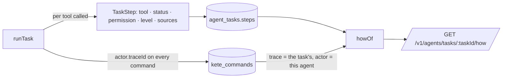
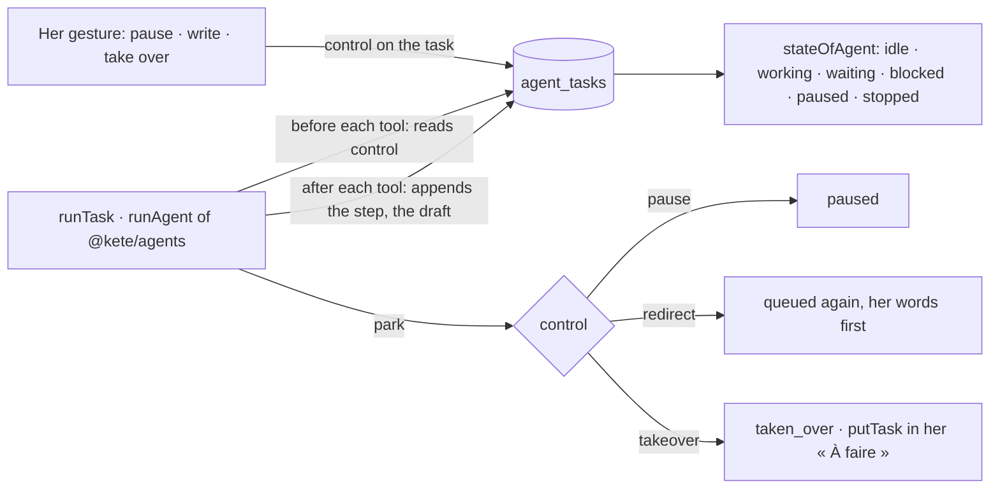
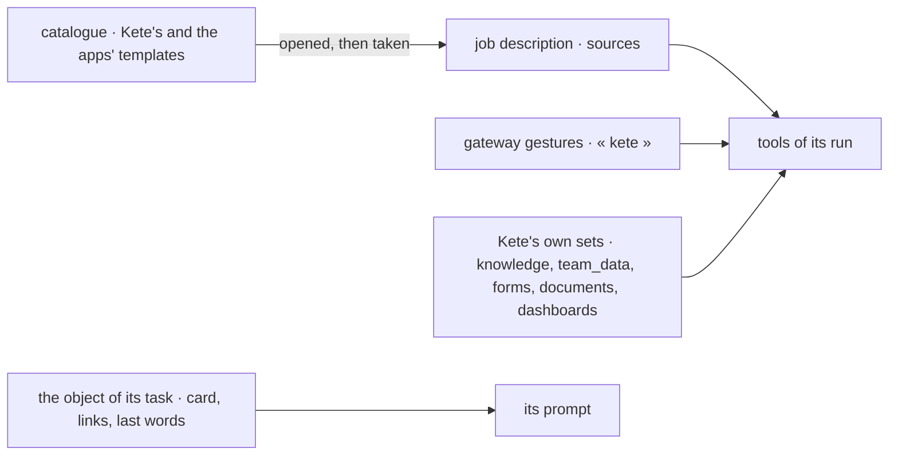
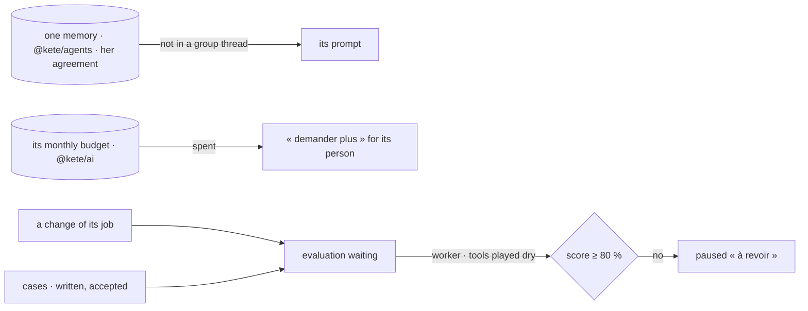
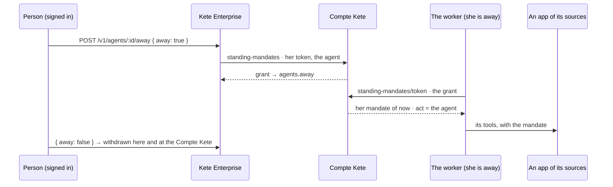

# Agents (spec 007)

Agents with a job description, asleep until woken, acting for a person and never beyond her
(doctrine D-039, principles 3 and 4). The first ones read and signal (level 1); they change
nothing.

```mermaid
sequenceDiagram
  participant W as Worker (pg-boss, every 5 min)
  participant D as agents_due() — definer
  participant A as Agent (its organization's transaction)
  participant F as Watches (registry, decisions, …)
  W->>D: which agents are due?
  D-->>W: (organization, agent) — identifiers only
  W->>A: wake
  A->>A: whom does it act for today? (its person, or its position's holder)
  A->>F: what's wrong, in her reach ∩ its scope ∩ its permissions?
  F-->>A: findings (each with a key)
  A->>A: raise-signal for each new key; close-signal for each key gone
  A->>A: sleep until now + wakeEveryMinutes
```

- **Job description**: name, kind (`personal`, `position`, `system`), mission, the person who
  answers for it (or the position whose holder it acts for), scope (a unit and below), permissions,
  highest autonomy level, budget of open drafts, wake period, watches. Every agent enters the
  registry (spec 004) in its person's space.
- **Its reach**: what its person sees (spec 003), narrowed to its scope and to the watches whose
  permission its job description lists. It never acts as an administrator.
- **One organization**: an agent lives and acts in its own; the worker learns only identifiers
  across organizations, then works each agent in its organization's transaction.
- **Traced**: every signal raised or closed is a named command, its actor
  `{ kind: 'agent', id, onBehalfOf: its person, channel: 'worker' }`.
- **Watches** are the features': `registry` (apps without a card or an owner, needs
  `registry:read`), `decisions` (steps waiting too long for its person); compliance's controls plug
  in with `registerWatch` (spec 008).
- **Stopped**: an agent paused by its person does nothing; the organization's `agents` module
  switched off stops every agent at once (the kill switch), whoever wakes them.
- **Running**: `main.ts worker` runs the worker alone; `KETE_WORKER_IN_PROCESS=true` runs it beside
  the API (a small instance, one container).

**Tasks given (spec 036).** A person gives one of her agents a task; the worker runs it every
minute with her capabilities narrowed to its job description (permissions, autonomy, budget of
drafts), every commitment a draft she decides; it may hand part of it to another of her agents
(`delegate_task`, the chain carried, four agents at most); she sees each task's answer, steps and
drafts, is told when it ends, and stops it. See [spec 036](../../../../../specs/036-agents/spec.md).

## Autonomy per kind of task, its record, an agent from a sentence (spec 052)

```mermaid
flowchart LR
  J[Job description · permissions · autonomy max] --> L[Level per permission · 1 read · 2 act, undoable · 3 prepare]
  L --> G[Gateway: tool.autonomy ≤ min(max, its permission's level)]
  T[agent_tasks] & D[kete_drafts it prepared] & S[agent_signals] --> R[GET /v1/agents/:id/record]
  P[Her sentence] -->|POST /v1/agents/understand| F[A proposed job description · nothing created]
```

- **Per permission** (`autonomy_by_permission`, migration 0043): its person or a manager of agents
  sets a level for a permission it holds, never above its maximum; level 4, committing, is never
  set per kind of task. Without one, its maximum applies.
- **Its record**: the last 7 days by default (up to 90): tasks by outcome, drafts it prepared by
  decision, signals raised and closed.
- **From a sentence**: only the watches that exist and the permissions she holds, a maximum level
  of 3 at most; created only when she presses « Créer cet agent ».

## « Comment ? » (spec 056)

How an agent did a task, from what was recorded when it ran.



- A step's permission comes from the registry (`toolPermissions`), its level from the tool, its
  sources from `platform/sources.ts` (the same reading as the chat's citations).
- Every task's actor carries its trace, delegated or not; a delegated work shares one trace, so
  `howOf` keeps the lines whose actor is the task's own agent.
- Read by whoever may see the agent (`ownAgent`): its person, or who manages agents.

## Agents at work (spec 066)

A task is steered while it runs, an agent is in one of six states, and it is private or shared.



- **Controls** (migration 0052): `control` is what she asked of a running task; `park` obeys it
  when the run returns or breaks. A task not running obeys in the gesture itself.
- **Steps** are appended by the tool wrapper, not at the end: `finish` only writes the outcome.
- **Shared** (`visibility`, `shared_with`): `openTo` decides who may call it; a called task acts
  for `given_by`, an owned one for the agent's person (`runTask`).
- **Followed by** who gave the task or the agent's person (`followedTask`).

## The dry run (spec 067)

`findingsOf` is the one reading of a job description — its watches, within its permissions and its
scope, with its person's rights. A round (`wakeAgent`) raises what it returns; a dry run
(`POST /v1/agents/dry-run`) only says it. So an agent's first round raises what its dry run said.

## Sources, context and the catalogue (spec 104)

Doctrine D-062 (R5), kete-core ADR 0018 and spec 146.



- `toolsets.ts`: Kete's own sets, each open when its module is on, each tool reading with her
  rights; `agentToolSets` keeps only the sets its sources name, within its level. Without « kete »
  in its sources, the gateway's gestures do not reach it either.
- `context.ts`: a task given in an object's thread starts with the object's card and the last words
  of its thread, read with its person's rights.
- `catalogue.ts`: Kete's templates and the apps' (`agent-template.v1`, checked); an administrator
  opens or closes one (`enable-agent-template`); a person takes an open one
  (`take-agent-template`): her agent, its subscriptions to the events it follows, its routine.

## Memory, budget, proof (spec 106)



- `budget.ts`: its monthly tokens (`kete_ai_budgets`, scope agent), what it spent this month; spent,
  its run stops `budget_spent` and its person holds « demander plus ».
- `evaluations.ts`: its cases — written by its person, or a task she accepted with the gesture it
  prepared —; an evaluation asked at every change of its job, run by the worker with its person's
  rights and its tools played dry; under the threshold it is paused.
- The memory is the assistant's (`../assistant/memory.ts`), on `@kete/agents`' tables.

## While its person is away (spec 108; kete-core spec 150)

A task runs in the worker — given in her thread, woken by a routine or by an event the agent
follows — and holds no token of hers: before, an agent reached none of the team's apps. Now, signed
in, she lets it act for her in her absence (« En votre absence » beside its thread): her token goes
to the Compte Kete as her consent, which keeps a **standing mandate** and answers its grant, written
on the agent (`agents.away`, migration `0084_agents_away`). At each task, when its job description
names one of the team's apps by its product (`prd_…` among its sources), the agent asks the Compte
Kete for its mandate of now — her claims read again, ten minutes — and receives those apps' tools
only (`appToolsAway`), each app applying its own rights and autonomy.



- **Hers alone to give**: the person it acts for, signed in (never while someone views her space);
  she or a manager of agents takes it back. Mandates off (`KETE_MANDATES`), it cannot be given.
- **Never more than her**: refused by the Compte Kete once withdrawn there (Mon espace Kete ·
  Sécurité) or once she has left; a grant given by someone it no longer acts for is not used.
- **Only its sources**: an app its job description does not name is not reached.
