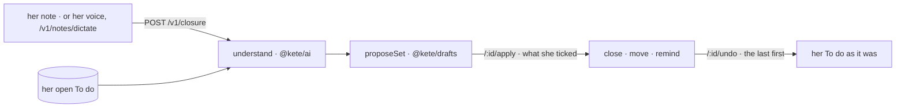

# Closure

The evening's closure (spec 083, doctrine D-051): her note, understood as gestures on her To do.

- **Offers**: `close` a task she says is done (level 2), `postpone` it to the day she names (level 2),
  `remind` her on a day she names (level 1). A move or a reminder without its day is left out.
- **Only her objects**: the model sees her open tasks and nothing else; a task it names that she does
  not have is never proposed.
- **Undone together**: what applying changed is kept with each item — a task's source, key, title,
  address and day — and put back as it was; a reminder filed is taken out.
- Another person's set is not hers to decide (404). Without a model: `assistant_unavailable`.
