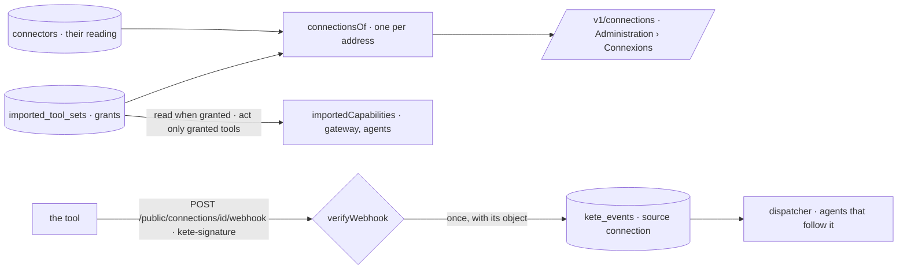

# One connection, three uses (spec 105)

Doctrine D-062 (R8, R17), kete-core ADR 0019 and spec 147: an organization's tool — its ERP, its
CRM — is reached once and seen once, with what it serves: **read** (Kete, the boards), **act** (its
agents, tool by tool, at a level, every commitment a draft), **signal** (what waits, into
« Décider »). Its health says « à reconnecter » where it fails. Its events arrive by a webhook signed
with its own secret, onto the one event path (spec 101).

- **Grants** (migration `0080_one_connection`): an imported set's `grants` — read, and its act tools
  each at a level (`@kete/connections`' `ConnectionGrants`). A set imported from now on reads and
  acts nowhere until an administrator grants a tool; the sets imported before keep their act tools
  as drafts. `importedCapabilities` offers a read only when it may read, an act only when granted.
  `set-connection-grants`, journaled with what they were.
- **One view** (`connectionsOf`): each set, and each connector on the same address as one more use
  (signal); its health — off, on trial, « à reconnecter » with the connector's last error.
- **A webhook** per connection: its secret made and sealed by the route, said once to the
  administrator — the journal keeps the sealed form only. `POST /public/connections/:id/webhook`
  checks `kete-signature` (HMAC-SHA256 of the exact body), refuses alike an unknown connection and a
  wrong signature, and keeps the event once (`kete_events`, source `connection`, with the object it
  names): an agent that follows its type wakes on it.
