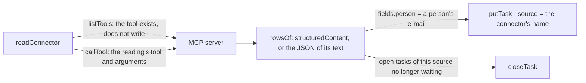

# Connectors

A business tool the organization already has, read through its MCP server (spec 069).

- `connectors.ts`: the table (credential sealed), the two commands, the reading. `file: false` is
  the trial; `file: true` files and closes.
- `infrastructure/presets.ts`: filled forms per business tool. The only place a vendor is named.
- A failed reading is kept on the connector (`noteFailure`) in a transaction of its own: the one
  that failed rolls back.
- The worker reads every connected connector across organizations through the definer function
  `connectors_connected()`, each in its organization's transaction.
