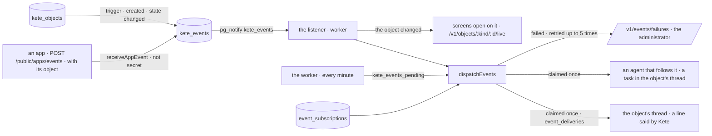

# One event path (spec 101)

Doctrine D-062 (R11) and kete-core ADR 0017 and spec 143: what changes says so, once, in one log —
and whoever depends on it learns it. Before, an app's event reached the routines and the morning
briefing only, and an object that changed state told no one.

- **The log** (`events.ts`, migration `0076_one_event_path`): `kete_events`, with its row-level
  security; select and insert only — a fact is never rewritten. Two sources: an app's business event
  (kept by `receiveAppEvent`, never a secret one), and the index — an object born
  (`object.created`) or changing state (`object.state_changed`, with `from` and `to`), by trigger.
- **Subscriptions** (`subscriptions.ts`): an agent follows a type (`object.state_changed`, or a
  family `ticket.*`), a kind of object, a state it reaches. Data, changed by journaled gestures
  (`follow-events`, `set-subscription`) by the agent's person or a manager of agents; a kind and a
  state must exist.
- **The dispatcher** (`dispatch.ts`): for each event not yet seen, each consumer — the object's
  thread for an app's event, each agent that follows it — is claimed in `event_deliveries` in the
  same transaction as its effect: a replay acts once. A failure is kept with its error and tried
  again, five times at most; the event is « seen » when every consumer is done or has given up. The
  listener dispatches as soon as Postgres announces an event; the worker's minute catches up.
- **Consumers.** The thread: one line said by Kete (`Support · Ticket résolu — Mini-centrale`),
  `via: kete`, for information. An agent: a task given in the object's thread (`giveToAgent`) —
  what happened, the object's title, the change of state in words; it proposes, it commits nothing
  alone.
- **Read.** `GET /v1/objects/:kind/:id/events`: what happened to an object she may read (an app's
  data never shown, only its words). `GET /v1/objects/:kind/:id/live`: a stream that tells the
  screen when the object changes; the screen then reads it again. `GET /v1/events/failures`: what
  could not arrive, for the administrator.
