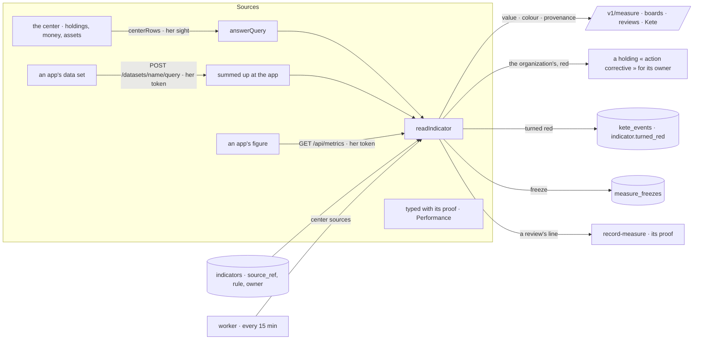

# The Measure (spec 102)

Doctrine D-062 (R2, R4, R7, R11, R17) and kete-core ADR 0015 and spec 144: one figure has one
definition — an indicator of the organization's referential — that names where it comes from, is
read live with the reader's rights and filters, says how it was obtained, is missing rather than
zero, and obliges someone to act when it turns red.

- **Indicators** (`measure.ts`, migration `0077_the_measure`): Performance's `indicators` gain a
  structured source (`source_ref`: `center`, `dataset`, `metric` or `typed`), a unit, a rule —
  direction, target, threshold, comparison, all four or none — and an owning position. A source
  counts one number: a measure of the rows, filtered by the source's own fields, or a percentage of
  two (`over`). Set by who manages the referential (`set-indicator-source`, journaled, reversible).
- **The center's sources** (`center.ts`): holdings, money facts and assets, declared as an app
  declares its data sets (`dataset.v1` with the four axes); a row counts for her when its object is
  hers to see (`sightOf`, the index's rule, R4).
- **A reading** (`readIndicator`): the center's rows summed up by `@kete/metrics`' `answerQuery`; an
  app's data set asked at the app with her token (`queryDataset`); an app's figure read with
  `readMetrics`. It carries its provenance — the source, the filters applied, the period, the rows
  counted, the moment. A source that does not answer is `missing`, coloured red; nothing to count
  for her is no figure and no colour; a figure she may not read is `denied`.
- **A colour has a consequence** (`consequence.ts`): an organization-wide reading — an
  administrator's, or the worker's every quarter of an hour for the center's sources — that turns
  red (past its threshold, or missing) gives the owning position's holder a holding « action
  corrective » with the figure and its source, and says `indicator.turned_red` on the event path
  (spec 101): an agent may follow it. A person's own reading never does: her sight is not the
  organization's.
- **Freezes** (`freeze-readings`): readings kept as they were read — a board's summary, a quarter's
  « arrêté » (D-052).
- **A review's line** (`POST /v1/measure/reviews/:id/lines/:position`): the line's indicator read
  for its person (or its unit) over the quarter, recorded by Performance's `record-measure` with its
  provenance as proof. A typed indicator stays typed.
