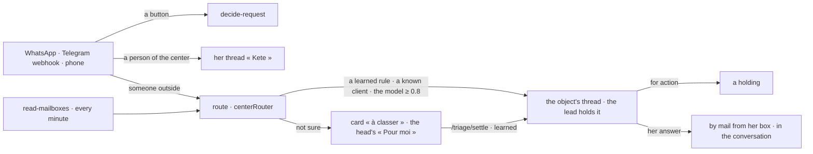

# Messages (spec 089)

Threads and channels in the center (doctrine D-056, D-057; kete-core `@kete/threads` and
`@kete/channels`): one thread per object, her thread « Kete », and a router that ties what the
outside says — WhatsApp, Telegram, mail — to its object's thread with a holder, never guessed.

- **The router of the center** (`centerRouter`): the triage person is the organization's head (else
  its assistant); a project's thread is held by its lead; a client known by her phone's last eight
  digits or her e-mail lands in her only open project's thread (else her party's; two parties with
  the same contact: a person decides); the model reads the rest when one is configured.
- **WhatsApp and Telegram**: the decisions' buttons work as before (spec 077); words without a
  button are routed and acknowledged, or kept in her thread « Kete » when she is of the center.
- **Mailboxes**: an administrator connects a person's IMAP and SMTP; the password is sealed with the
  instance's key and never returned. An answer in a thread whose contacts write by mail leaves from
  her box in the conversation (In-Reply-To the last mail; Reply-To the thread's address when it
  has one), kept in her Sent folder; their reply comes back.
- **Reading a thread**: its members now, and the administrators; opening it marks it read.

## Routes, under /v1/threads

| Route                               | What                                                                   |
| ----------------------------------- | ---------------------------------------------------------------------- |
| `GET /`                             | Her open threads                                                       |
| `POST /`                            | A group or a direct thread she opens and holds                         |
| `GET /kete`                         | Her thread « Kete »                                                    |
| `GET /search?q=`                    | Words in the threads she reads                                         |
| `GET /of/:kind/:id`                 | An object's thread                                                     |
| `POST /triage/settle`               | A card « à classer » placed — and learned unless `learn: false`        |
| `GET /mailboxes`, `POST /mailboxes` | The mailboxes the center reads (administrators); never a password back |
| `GET /:threadId`                    | A thread and its messages, read as she opens it                        |
| `POST /:threadId/messages`          | A message, for action or information; by mail to its mail contacts     |
| `POST /messages/:messageId/edit`    | Its author edits it; the original is kept                              |
| `GET /:threadId/export`             | Its journal and fingerprint; `?format=pdf` with the conversion service |
