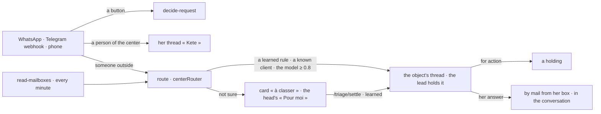

# Messages (spec 089)

Threads and channels in the center (doctrine D-056, D-057; kete-core `@kete/threads` and
`@kete/channels`): one thread per object, her thread « Kete », and a router that ties what the
outside says — WhatsApp, Telegram, mail — to its object's thread with a holder, never guessed.



- **The router of the center** (`centerRouter`): the triage person is the organization's head (else
  its assistant); a project's thread is held by its lead; a client known by her phone's last eight
  digits or her e-mail lands in her only open project's thread (else her party's; two parties with
  the same contact: a person decides); the model reads the rest when one is configured.
- **WhatsApp and Telegram**: the decisions' buttons work as before (spec 077); words without a
  button are routed and acknowledged, or kept in her thread « Kete » when she is of the center.
- **Mailboxes**: an administrator connects a person's IMAP and SMTP; the password is sealed with the
  instance's key and never returned. An answer in a thread whose contacts write by mail leaves from
  her box in the conversation (In-Reply-To the last mail; Reply-To the thread's address when it
  has one), kept in her Sent folder; their reply comes back.
- **Reading a thread**: its members now, and the administrators; opening it marks it read.

## Routes, under /v1/threads

| Route                               | What                                                                   |
| ----------------------------------- | ---------------------------------------------------------------------- |
| `GET /`                             | Her open threads                                                       |
| `POST /`                            | A group or a direct thread she opens and holds                         |
| `GET /kete`                         | Her thread « Kete »                                                    |
| `GET /search?q=`                    | Words in the threads she reads                                         |
| `GET /of/:kind/:id`                 | An object's thread                                                     |
| `POST /triage/settle`               | A card « à classer » placed — and learned unless `learn: false`        |
| `GET /mailboxes`, `POST /mailboxes` | The mailboxes the center reads (administrators); never a password back |
| `GET /:threadId`                    | A thread and its messages, read as she opens it                        |
| `POST /:threadId/messages`          | A message, for action or information; by mail to its mail contacts     |
| `POST /messages/:messageId/edit`    | Its author edits it; the original is kept                              |
| `GET /:threadId/export`             | Its journal and fingerprint; `?format=pdf` with the conversion service |

## Threads people live in (spec 098)

```mermaid
flowchart LR
  O[a project · a third party · an app's object] -->|born with it| T[its thread]
  T --> L[GET /threads · unread · last message · ✔]
  T --> V[GET /threads/:id · actions · cards · dates · files · done · link]
  P[POST /threads/:id/messages] -->|internal| T
  P -->|outside| G{message.client · the policies}
  G -->|allowed| D[mail from her box · WhatsApp 24 h or template · Telegram]
  G -->|approval| W[outside_pending · a holding per approver] -->|approved| D
  P -->|@Kete · her thread « Kete » · a group's orders| K[Kete's turn · door.ts · her rights] --> T
  T -->|pg_notify| E[GET /threads/events · Server-Sent Events]
```

- **Live**: one listener per process (`live.ts`) on Postgres' announcements; each open screen gets
  a Server-Sent Events stream of the changes in threads its person reads. Without a direct
  connection, each stream asks what changed every 4 seconds.
- **The list** (`GET /`): her open threads by last activity, unread counts, last message and open
  actions; projects and third parties made before get their thread the first time it is read.
- **A thread** (`GET /:threadId`): its messages (quoted answers, files, moves, mentions), the
  actions asked in it with their holder, due day and priority, the outside messages waiting for an
  approval, the cards of its object, its dated facts, files by name with versions, what was done
  lately, and « Ouvrir la fiche ». Names come from the structure, else the signed-in account, else
  « Quelqu'un hors de l'organisation » — never an identifier.
- **Internal or outside**: a message is internal unless `visibility: 'outside'`; then it is the
  gesture `message.client` on the thread's third party. Without a policy naming it, it leaves; with
  one, the policies decide (a forbid or an approval alone leaves the rest allowed, as for the apps).
- **Kete in the thread**: a mention of `agt_assistant` (« @Kete ») or « Créer… » asks the assistant
  with her rights; its answer comes into the thread, what commits as a draft.
- **An app's object** (`POST /v1/apps/:product/threads`): its thread, held by who created it, its
  app address kept for « Ouvrir la fiche », the third party's mail joining.
- **The digest**: who chose `kete.threads_digest` gets, once a day after 18 h, her unread threads.

| Route                               | What                                                           |
| ----------------------------------- | -------------------------------------------------------------- |
| `GET /events`                       | Server-Sent Events: a thread she reads changed                 |
| `POST /:threadId/unread`            | Marked unread from a message on                                |
| `POST /:threadId/members`           | Its holder adds and removes members                            |
| `POST /:threadId/files`             | A file (base64, 10 MB at most); the same name is a new version |
| `GET /files/:fileId`                | A file, for the thread's members                               |
| `POST /messages/:messageId/move`    | Moved to another of her threads                                |
| `POST /messages/:messageId/draft`   | Kete prepares a draft from it                                  |
| `POST /messages/:messageId/outside` | An approver decides an outside message                         |
| `POST /actions/:holdingId/done`     | Its holder says the action is done                             |

## Kete, the door (spec 099, FR-007 to FR-011)

`door.ts` is Kete's turn and what it proposes; `door-routes.ts` her decisions.

- **A turn** (`startTurn`) runs in the background with her rights and her tools, plus three door
  tools that only collect: `propose_gestures`, `propose_policy`, `hand_to_agent`. Its steps and
  words are kept in `kete_turns` as they come (`GET /:threadId/turn`); `POST /turns/:turnId/stop`
  stops it, and what was said stays. Read unasked (a group's message that gives orders), it speaks
  only to propose, and only to its author.
- **What it read, drawn** (spec 111): the rows a tool read and says how to show (`tableOf`) are kept
  with the turn's run (`thread_runs.tables`, migration `0086_run_tables`) and drawn under its answer
  — never only announced.
- **What it proposes** waits under its message (`kete_proposals`, returned by `GET /:threadId` as
  `proposals`): `POST /proposals/:id/confirm` (the gestures she keeps, as corrected) makes the
  holdings — « pour action » messages in the object's thread, returned to whom she names —, the
  dated facts and the routines; `POST /proposals/:id/decline`; `POST /proposals/:id/policy`
  (`adopt` or `trial`, an administrator) saves the template's policy through the policies' own
  commands.
- **Her thread « Kete »**: the drawer writes into it (`keepInKete`, the page kept in
  `kete_message_pages`); `POST /:threadId/invite` turns it into a group, and the next question
  opens a new one; `handed` lists what her agents work for her.

## Agents as colleagues (spec 099, FR-013 to FR-017)

`agent-threads.ts` is an agent's thread and what passes in it; `agent-routes.ts` her gestures.

- **Its thread** (`agentThreadOf`, `agent_threads`): her words there are its work (`speakToAgent`:
  a task, or a note to the task at work); `GET /:threadId` adds `agent` (its job description at
  work) and `requests` (its drafts under its answers). The task at work is the thread's `turn`.
- **Its answer** (`agentAnswered`, called by the task runner): posted where it was asked, its
  steps in `thread_runs`; a holding it worked returns to whom its job description says.
- **Its requests** (`POST /requests/:draftId/once|always|refuse`): « always » allows this one and
  proposes `agent.<agent>.<capability>`, simulated, hers to adopt; a routine's request expires
  after ten minutes.
- **What it takes on** (`offerHolding` on every holding given in a thread, `mentionedAgents`):
  never, a `takeon` proposal for the holder (`POST /proposals/:id/takeon`), or alone.
- **Its job description at work** (`POST /agents/:agentId/job`, the command `set-agent-job`),
  its routine now (`POST /agents/:agentId/routine/now`), her agents by state (`GET /agents`).

## Mail as decided (spec 099, FR-018)

`mail-settings.ts`: what Kete reads in a box (`touchesObjects`, used by `readMailboxesOf` for a
personal box, its INBOX and its Sent folder; its « Kete » folder is read whole; a shared box is read
whole), `GET /mailboxes/overview` (each box, its week, the routing steps' counts, the threads'
domain, the channels heard live), `POST /mailboxes/:userId/rules`, and `originalsOf` (a thread's
mails as they came, in `GET /:threadId` as `originals`). A mail from a Sent folder is its person's
(`centerRouter`'s `authorOf`).
