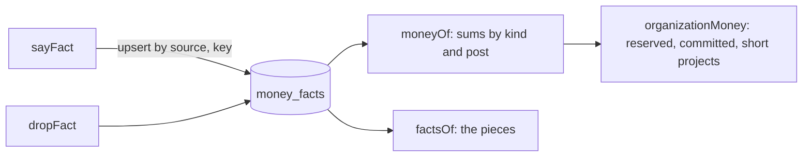

# Money by project

The facts of money the apps say, added up by the center (spec 076, doctrine D-049).

- The contract is kete-core's `money-fact.v1`; `moneyFactInput` mirrors it (snake case, strict).
- **The app owns its facts.** It keeps an invoice's amount at what is still due and a commitment's
  at what is still to pay; the center never changes a fact.
- `available = received − spent`; `short` is what commitments exceed it by, plus what was spent
  beyond what was received.
- Every figure is a sum of integers of the currency's smallest unit. One currency per project.
