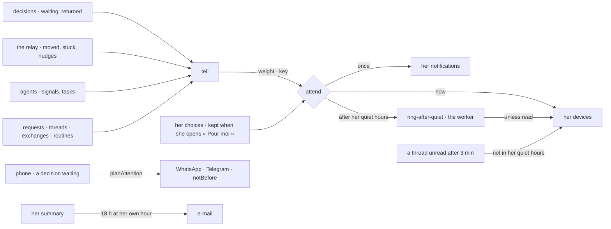

# Notifications and attention (specs 030 and 109)

What a person is told, on `@kete/notify`: her notifications in Kete Enterprise (« Pour moi » and
the bell), and her devices by Web Push when she asked for it. A notification informs; what asks for
an action stays in « À faire » and « Pour moi ».

## One attention model (spec 109; kete-core spec 151; doctrine D-062, R14)

Every path that tells someone goes through `tell`, which weighs the signal and lets the one model
decide — `attend` in `@kete/notify`:

- **Weight**: what asks her to act (`decision.waiting`, `holding.nudged`, `thread.mentioned`,
  `agent.signal`…) rings her devices — at once, or once her quiet hours end; what she only needs to
  know waits in her list. A nudge on an urgent holding rings at any hour.
- **Once**: a signal with a key is told once — a decision's step, a holding moved to someone, a
  nudge a day, an agent's signal. Without a key, each call is its own signal.
- **Her choices** (`kete.quiet_hours`, `kete.time_zone`, `kete.notification_channels`,
  `kete.threads_digest`) live in the Compte Kete; they are kept on her person
  (`people.attention`) each time she opens « Pour moi », for the worker, which holds no token of
  hers. Before that, Kete's defaults.
- **Her phone**: a decision waiting goes to the phone she tied — at once, or once her quiet hours
  end (`queueChatText … notBefore`).
- **Threads**: a message unread three minutes after rings her devices as her level for the thread
  says — never in her quiet hours; she reads it in the thread.
- **Her summary**: once a day after 18 h at her own hour — her time zone, or her organization's.
