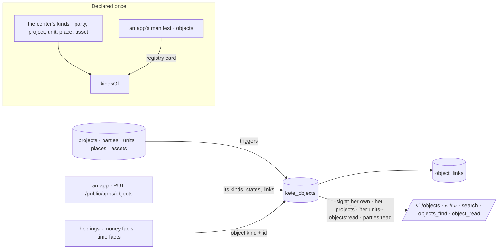

# Objects at the center (spec 100)

Doctrine D-062 (R1, R2, R4, R15) and kete-core ADR 0014: one index of every object that matters —
the center's references and the apps' objects — with what finds, cites, filters and rights them:
its title, its state, its four axes (project, party, unit, person), its named links. Never an app's
data: the reader reads it at the app, with her own rights.

- **Kinds** (`kinds.ts`): the center declares its references the way an app declares its kinds
  (`object-type.v1`): party, project, unit, place, asset — states, axes, named links with their
  inverse words, where one opens. An app's kinds are read from the manifest the registry already
  keeps; an app cannot take a center kind's name, nor another app's.
- **The index** (`objects.ts`, migration `0075_objects_at_the_center`): `kete_objects` and
  `object_links`, with their row-level security. Projects, parties, units, places and assets keep
  their row by triggers; an app says its objects with its own token (`PUT /public/apps/objects`,
  kete-core `sayObjects`) — only its declared kinds, states and links, an older saying never
  replacing a newer one, `gone` taking one out.
- **Sight** (`sightOf`, `sightSql`): the same rights as everywhere (R4). An object is hers to see
  when she answers for it, belongs to its project's team or reads every project, works in its unit
  or holds `objects:read` over it, reads the third parties it concerns, or when it has no axis at
  all. A confidential kind travels only to its person and its project's team. A link is shown only
  when its other end is hers to see.
- **Places and assets** (`assets.ts`): two references born here (D-056). An asset is what the
  organization installs or owns and keeps — born of a project, living on after it; a place is where
  things are. Each is born with its thread. Who manages the objects (`objects:manage`) declares
  them; who answers for an asset changes its state.
- **Found the same way everywhere**: `/v1/objects` (by words, kind, axis, state), one object with
  its links both ways and what is in progress about it, « # » in the threads, the search, and the
  gateway's `objects_find` and `object_read` for Kete, the agents and the copilots. A money fact
  and a time fact may name their object.
