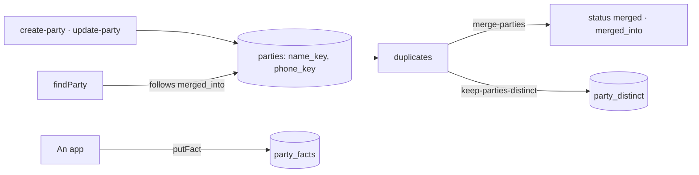

# Third parties

Who the organization works with (spec 073, doctrine D-047): a reference of the center, cited by
every app by its identifier.

- `nameKey` and `phoneKey` are what duplicates are compared by: a name without case, accent,
  punctuation nor legal form; a phone's last eight digits.
- `findParty` follows a merged record to the one that stays: every reader goes through it.
- A merge moves the facts and the earlier merges to the record that stays, in one transaction.
- Rights: `parties:read` and `parties:manage`, held like any other permission (`reach`).
