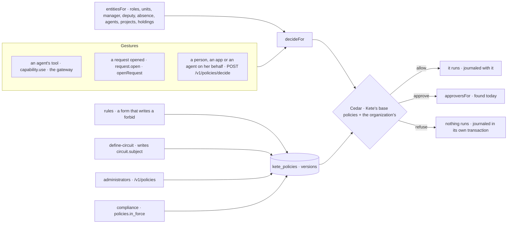

# Policies (spec 088)

One policy engine at the gesture (doctrine D-058; kete-core `@kete/policies`, on Cedar): « who
may do what, up to how much, with whose approval » has one answer in the center, the same for a
person and for her agent, journaled with the policy that decided it. The agents' rules (spec 068)
and the circuits (spec 005) are policies of this engine.

- **The center's schema** (`schema.ts`): a person is in her roles and units, with her manager,
  her deputy and whether she is away today; an agent works for a person, with its autonomy; a
  project has a lead, a card (a holding) a holder. A policy reads a role as
  `principal in Kete::Role::"rol_…"` — the rights stay what they are (D-058). The gestures:
  `capability.use`, `request.open`, `contract.sign`, `purchase.commit`, `invoice.issue`,
  `assignment.make`, `message.client`, `document.read`, `document.delete`, `card.decide`. A context
  attribute an app may not know is optional: a policy reads it with `has`. A gesture the center
  does not know is refused before the engine. The apps ask about theirs (`appGestures`, spec 091):
  while no policy in force speaks of one (`ruledHere`), it is left to the app's own rules.
- **Kete's base policies**, the same everywhere and never stored: a tool given to an agent may be
  used, a request opened. Everything else needs the organization's own permits: nothing is allowed
  that nobody allowed.
- **Born on trial.** Every version an administrator saves is on trial: journaled, never enforced.
  It is switched on only once its rule was observed on trial. A rule of the agents is switched
  through `/v1/rules`, once tried on the last month; a circuit's policy applies from its definition.
- **Approvers found today** (`approversFor`): `manager` (away: her deputy), `on_behalf_of` (the
  person an agent works for), `project.holder`, `role:…`, `position:…`, `person:…` — as a circuit's
  step finds them —, `circuit` (the circuit's own steps). Never the one who asks.
- **Journaled.** An allowance or an approval is journaled with the gesture's change; a refusal in
  a transaction of its own, so it stays when the refused gesture is rolled back.
- **A sentence, then its rule.** The model proposes the Cedar rule of an administrator's sentence,
  checked against the schema (`/propose`); nothing is kept until she saves it.

## Routes, under /v1/policies

| Route                    | Who            | What                                                                  |
| ------------------------ | -------------- | --------------------------------------------------------------------- |
| `GET /`                  | administrators | Kete's base and the organization's policies, what each did this month |
| `GET /journal`           | administrators | The decisions, the latest first; `?policyId=` for one policy          |
| `GET /:policyId`         | administrators | A policy's versions and its decisions                                 |
| `POST /propose`          | administrators | The model's rule for a sentence, checked                              |
| `POST /check`            | administrators | Whether a rule fits the schema, and why not                           |
| `POST /`                 | administrators | `save-policy`: a new version, on trial                                |
| `POST /:policyId/status` | administrators | `set-policy-status`: on, on trial, off                                |
| `POST /decide`           | everyone       | A `gesture.v1` for herself or her agent; a `policy-decision.v1`       |

The demo writes KYA's six policies (`db/demo/kya-policies.ts`).
