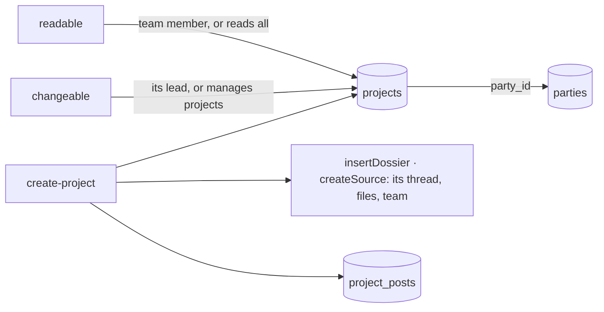

# Projects

What the organization works on (spec 074, doctrine D-047): a reference of the center, one object.

- A project **is** a dossier plus its business side: its team is the dossier's members, so
  whoever joins it reads its thread and files (`dossier_members`).
- `bornFrom` (source, ref) is unique: an app asking twice gets the same project.
- Amounts are integers of the currency's smallest unit (`sold_amount`, `budget_amount`).
- `projectIdsOf(db, userId)` is the second axis of rights, for the features and the apps that
  filter by it.
