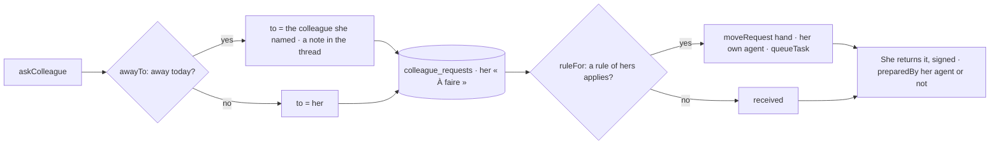

# Requests to colleagues, and « Mon accueil »

Work asked of a person (spec 065), and what becomes of it when it arrives (spec 067) — doctrine
D-044.

- `requests.ts`: the request, its states, its thread; each move is the gesture of one of its two
  people. `reception.ts`: her rules (`reception_rules`) and her absence (`reception_absences`),
  read only by her.
- A rule applies when its agent is hers and active and the organization's agents are on
  (`receptionOf`). The hand-over it makes is the same move she would make herself.
- Days are read as text (`::text`): a `date` read as a moment shifts with the server's time zone.
