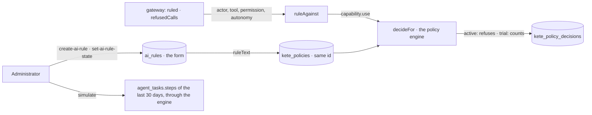

# Rules

The organization's rules for its agents (spec 068, doctrine D-043).

Since spec 088 a rule is a **policy** of the one engine (`features/policies`, doctrine D-058): its
form — family, sentence, permissions, when it was tried — stays in `ai_rules`; its state, its
versions and what it refused are the policy's.

- `ruleText(rule)`: the Cedar forbid of a rule — its permissions (none: all); a rule on autonomy
  covers level 2 only — reading and preparing a draft are not acting alone.
- `ruleAgainst` asks the engine for a `capability.use`; the gateway calls it for every tool an
  agent is given and for a copilot's calls. A person's own gesture never passes through it. Any
  policy may refuse there, or ask an approval — the agent then does not act alone either.
- A rule is activated only once `simulated_at` is set (`simulate`, which runs the engine with the
  rule switched on over the last month's steps). The refusals and the counts are read from the
  journal of decisions; the old journal was carried into it (migration 0064).
