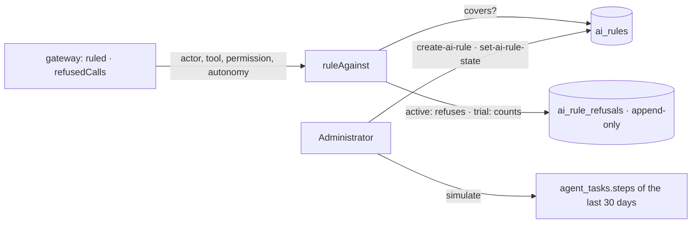

# Rules

The organization's rules for its agents (spec 068, doctrine D-043).

- `covers(rule, gesture)`: the rule's permissions (none: all); a rule on autonomy covers level 2
  only — reading and preparing a draft are not acting alone.
- `ruleAgainst` is the only place a rule is applied; the gateway calls it for every tool an agent
  is given and for a copilot's calls. A person's own gesture never passes through it.
- A rule is activated only once `simulated_at` is set (`simulate`).
