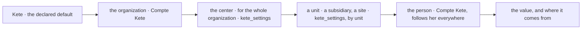

# Settings (spec 092)

Kete's settings in the center (doctrine D-060; kete-core `@kete/settings`, specs 115 to 117;
kete-core decision 0013): declared once by Kete, resolved by layers — the most precise wins, and
the screen says where each value comes from.

- **`GET /v1/settings`**: every setting with its value and its layer, as it applies to her;
  `?unitId=` — for an administrator — as it applies at a unit, the units above it included (a
  site under its subsidiary under the group).
- **`POST /v1/settings`**, **`POST /v1/settings/clear`**: her preference goes to the Compte Kete
  (never while an administrator views the space as her); the center's (`app`) and a unit's
  (`entity`) are set and taken back by an administrator, checked against the declaration and
  journaled in `kete_setting_events`.
- **`settingsIn(db, organizationId, unitId?)`**: what a command or a job reads, with no person's
  token at hand — the center's and the unit's layers over the organization's as a member last read
  it; never a person's own.
