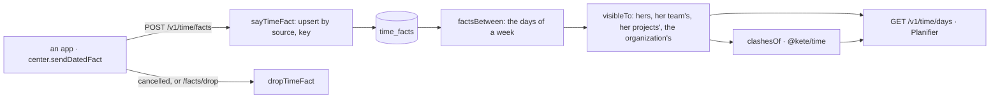

# Time

The time the apps say, for Planifier (spec 079, doctrine D-050).

- The contract is kete-core's `dated-fact.v1`; `datedFactInput` mirrors it (snake case, strict,
  exactly one of `day` and `starts_at`).
- **The app owns its facts.** Said again under its key, a fact is replaced; `cancelled`, it is gone.
  A person says the facts that concern her only; `time:record` says the time of others.
- **What she sees** (`scope`): `me` — hers, her projects', what concerns no one in particular;
  `team` — and her reports'; `organization` — everything shared, with `time:read`.
- **Masked**: a `private` fact only by the people it concerns; a `busy` one and another person's
  absence without their words — never the reason of an absence.
- What clashes — someone expected while away, someone in two places — is computed by `@kete/time`
  over what she sees.
