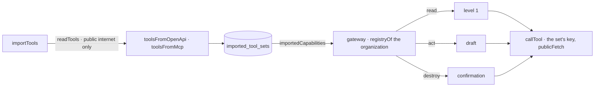

# Tools

The organization's own tools — described by OpenAPI, or served by a remote MCP server — imported by
an administrator and given to its agents under Kete's rules (spec 093, kete-core spec 124).

- `tools.ts`: the table (key sealed), the two commands, the capabilities. The tools are read once
  at the import and kept: an agent never meets a tool nobody saw.
- `infrastructure/public-fetch.ts`: https only, every resolved IP public, no redirection, a timeout
  and a bounded answer — for the import and for every call. `useToolsFetch` is the tests' door.
- The gateway (`../gateway/mcp.ts`) builds each organization's registry from the gateway's
  capabilities and its active sets, kept until one of its sets changes (`toolSetsVersion`). Kete's
  own names are reserved (`reserveToolNames`): an import never shadows one.
- Permissions: `tools:read` for a read, `tools:act` for an act or a destruction — administrators
  hold both.
