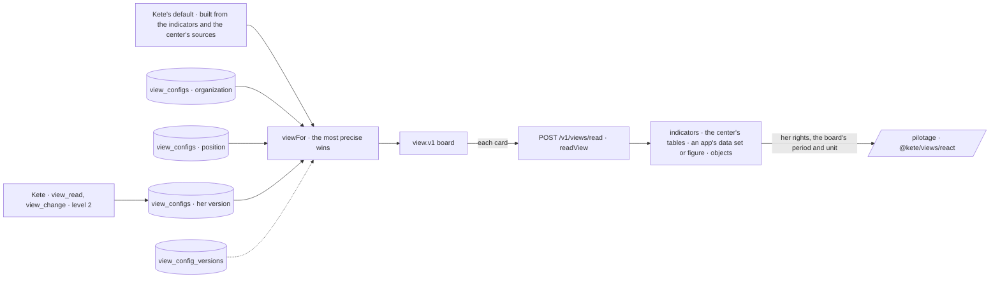

# Views configured where they are used (spec 103)

Doctrine D-062 (R16, R22) and kete-core ADR 0016 and spec 145: a place — the steering board first
— shows a `view.v1` document, data and never code: Kete's default, the organization's, a position's
or the person's own version. The most precise wins, whole. Every change is a journaled gesture that
keeps the version before it.

- **Layers** (`configs.ts`, migration `0078_view_configs`): `view_configs` holds one view per place,
  level and owner (the organization, a position, a person); `view_config_versions` keeps each
  version, a set-aside included. `set-view` (an administrator for the organization or a position,
  anyone for herself), `restore-view` (back to a version, or to none — the level below shows
  again), `set-my-view` (her own, as Kete writes it): all journaled. A view is checked against
  `view.v1` where it is written.
- **Defaults** (`defaults.ts`): « Pilotage » is built from the organization's own indicators — the
  scorecard of the first twelve, a bullet for the first two with a rule — and the center's sources:
  the fleet by state and by unit, what waits by subject, the money invoiced month by month and in
  cumulative.
- **Reading a card** (`read.ts`): indicators through the Measure (spec 102); a center table summed up
  by `@kete/metrics`; an app's data set asked at the app with her token; an app's figure; objects of
  a kind. A unit, a project, a third party it groups by are named. What is not known is a state —
  empty, missing, denied — never a zero.
- **Kete** reads a place's view (`view_read`) and changes her own version on a sentence
  (`view_change`, level 2): journaled, and undone by going back to the version before.
- **The screen** « Pilotage » (`/pilotage`): the board's cards on a 12-column grid, one per screen on
  a phone in its declared order, the period and the unit as the board's filters, « D'où vient ce
  chiffre ? » on every card, « Revenir au tableau commun » for her own version.
