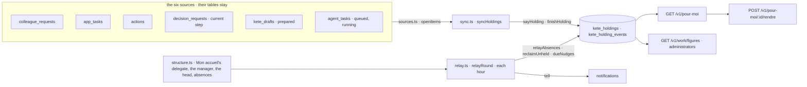

# work — the center's holdings

Spec 087 (decision 0002; doctrine D-056, D-057). Every thing in progress in the center is one
holding of `@kete/work` (kete-core spec 111): one holder, a person or an agent, never nobody.

| Source                      | Holder                                                                | Waits on                           | Closes when                   |
| --------------------------- | --------------------------------------------------------------------- | ---------------------------------- | ----------------------------- |
| A colleague's request       | the colleague asked                                                   | the requester, when she asked back | returned, declined, cancelled |
| An app's task (« À faire ») | its person                                                            | —                                  | done                          |
| A meeting's action          | its responsible person (her account)                                  | —                                  | done or cancelled             |
| A circuit's current step    | its first approver today, else the head; the requester when sent back | —                                  | decided                       |
| A draft an agent prepared   | the person it was prepared for                                        | —                                  | validated or refused          |
| An agent's task             | the agent                                                             | —                                  | done, failed or stopped       |

- **The sync** runs each minute (worker `sync-holdings`) and before « Pour moi » and the figures
  are read. An item unchanged is not written again; a holding the relay gave to a delegate keeps
  her while its source still names the absent holder.
- **The relay** runs each hour (worker `relay-holdings`): a person away today (« Mon accueil »,
  Planifier's absences) hands her holdings to the delegate she named, else her manager, else the
  head (who holds a position reporting to none); a holder who left hands over to her manager; a
  wait is nudged in working hours. The new holder is told; what nobody can take, the head is told.
- **Hand back**: the person the relay gave a holding to returns it, with her reason; its holder is
  told.
- Holders are accounts (`usr_…`); a person without an account holds by her person id. The words
  come from the notifications' catalog.
