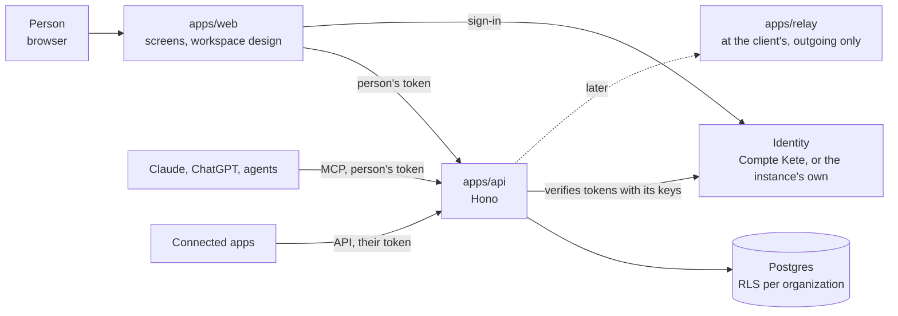
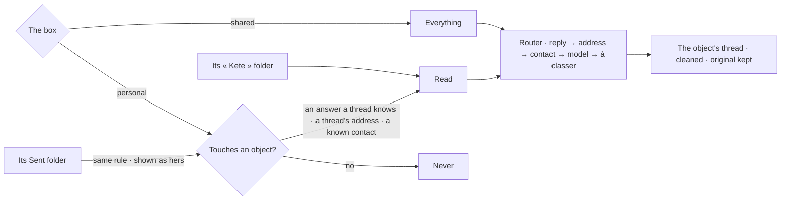

# Architecture

Kete Enterprise is the chain of a company: what exists between its tools (doctrine D-028). This
document says how it is built; `docs/ROADMAP.md` says in which order.

## The pieces



- **One door: the API** (D-029). The screens, the MCP gateway, agents and connected apps all go
  through it, with a person's token; it owns the database. Nothing reaches the database another way.
- **The screens hold no data.** They sign the person in with the identity, keep her token
  server-side only, and call the API on her behalf: never more than her rights.
- **The identity** is the Compte Kete on Kete's shared instance; an autonomous instance has its own
  (D-011, D-028). The API only needs its issuer address and published keys.
- **The organization is the boundary** (D-041): every table carries `organization_id` and its RLS
  policy in the same migration; the API connects with a role that cannot bypass it.

## Inside the API

```
apps/api/src/
  app.ts                 the routes: /health, /.well-known/kete, /v1/* behind a person's token
  platform/              the wiring, no business rule: env, database, identity, manifest
  features/<feature>/    one vertical slice each: domain, commands, queries, routes, README
db/migrations.ts         every table with its row-level security, in order
```

Features (in order, `docs/ROADMAP.md`): `structure`, `rights`, `registry`, `decisions`, `gateway`,
`agents`, `compliance`. A feature is used only through its `index.ts`.

kete-core's building blocks do the common work (D-030): `@kete/tenancy` (organization transactions),
`@kete/commands` (named gestures, journal, chain of agents), `@kete/drafts` and
`@kete/capabilities` (the AI prepares, a person decides), `@kete/sdk` (manifest, health, outbox),
`@kete/auth` (tokens), `@kete/jobs` (the worker), `@kete/design` (screens), `@kete/work` (holdings
and the relay, spec 087), `@kete/policies` (one policy engine at the gesture, on Cedar — the
agents' rules and the circuits are its policies, spec 088), `@kete/threads` and `@kete/channels`
(a thread per object, the router, mail bridged, spec 089).

## The threads (spec 099)

The enterprise talks in its threads (doctrine D-061). `@kete/threads` keeps every message once —
the thread of an object, a group, a direct one, her thread « Kete » —, `@kete/conversation` draws
them on the canvas v6.2, and the API (`features/messages`) adds what a center needs around them:

- **Files and voice notes** go to the storage (`platform/storage.ts`: S3 when `KETE_STORAGE_*` is
  set, a disk otherwise), 100 MB at most, served to the thread's members only; a voice note is
  transcribed after, by the organization's model, metered.
- **Pages**: a thread opens at her first unread message (80 around it), older pages on demand.
- **Live**: every change reaches her screens by the stream (`/api/fils/flux`); « écrit… » is told,
  never kept.
- **The phone** rings only for a message she has not seen in three minutes, once, by her level
  (all, mentions, none) — the worker's job `ring-threads`.
- **Kete in a thread** answers « seulement pour vous » when it read beyond the thread and others
  read it; she may share the answer. Its turn is kept with its steps (`thread_runs`).
- **Elsewhere**: a WhatsApp or Telegram export, or a mail, is imported once (each message keyed);
  two threads merge by the holder of the first.
- **An agent** is never a holder: a task given to it is held by the person who gave it, the agent
  its delegate, and the result returns to her (`holding.returned`).

```mermaid
flowchart LR
  F[The composer] -->|text, @, #, files, voice| A[API · messages]
  A --> T[(kete_messages and their marks)]
  A --> S[(Storage · S3 or disk)]
  A -->|@Kete| K[Kete] -->|only for her when it read beyond| T
  T -->|announce| L[Stream · her screens]
  T -->|unseen 3 min| P[Push · her phone]
  M[Mail, WhatsApp, Telegram] -->|reply headers → address → contact → model → à classer| A
  I[An export .txt, .json, .eml] -->|once per message| A
```

### Kete, the door (spec 099, FR-007 to FR-011)

Her thread « Kete » is her single conversation with Kete: the page « Kete » shows it, and the drawer
of every page writes into it, with the page as context (`kete_message_pages`); the conversations
kept before stay readable (« Conversations d’avant »). Kete takes a **turn** (`messages/door.ts`)
when she writes in her thread « Kete » or sends it a voice note, when « @Kete » is written in a
thread, from « Créer… » — and, unasked, when a message of a group gives orders to people: it then
speaks only to propose, and only to its author. A turn runs in the background with her rights and
her tools, plus three door tools that only **collect**: `propose_gestures` (holdings with whom,
when, how urgent and whom to return to; dated facts; routines), `propose_policy` (a template of
`@kete/policies`, simulated over thirty days) and `hand_to_agent` (a part for one of her agents,
handed at once). Its steps are kept (`kete_turns`, then `thread_runs`); « Arrêter » stops it. What
it proposes waits under its message (`kete_proposals`): nothing exists before her « oui », which
makes the holdings in the object's thread — where the account of what was said is posted, signed
by her —, the dated facts in Planifier and the routines; an administrator adopts a policy or puts it
on trial. « Inviter quelqu’un » turns her thread « Kete » into a group.

```mermaid
flowchart LR
  D[The drawer · any page] -->|her question + the page| KT[Her thread « Kete »]
  KT --> T{Kete's turn · her rights}
  G[@Kete · a group's orders · a voice note] --> T
  T -->|steps · Arrêter| R[(kete_turns → thread_runs)]
  T -->|answers| KT
  T -->|proposes| P[(kete_proposals)]
  P -->|her « oui »| H[Holdings in the object's thread · dates · routines]
  P -->|an administrator| PO[A policy · on trial or in force]
  T -->|hands a part| A[Her agents · in parallel]
```

### Agents as colleagues (spec 099, FR-013 to FR-017)

Each agent has a thread with each person who gives it work (`agent_threads`; a direct thread, her
and the agent). Her words there are its work: a task (`giveToAgent`), or a note to the task at work
— she speaks to it without stopping it; « Arrêter » stops it. When a task ends, its answer is posted
where it was asked (`agent_task_threads`), its steps folded under it; its drafts are its **requests**,
answered « Autoriser une fois », « Refuser », or « Toujours… »: allowed this time, and proposed as
her policy `agent.<agent>.<capability>`, simulated over thirty days, which — once in force —
decides that agent's drafts of that capability for her (never to sign or to pay). A request born of
its **routine** (`agents.routine_*`, the worker's `agent-routines`) expires after ten minutes, and
nothing leaves. Its job description says what it **takes on**: a holding of its person it covers,
any other of hers, a mention in a thread — never, it proposes (a « Confier à l'agent » card for the
holder), or alone (the holding delegated, still hers); its own **computer** with its minutes a
month; whom it **returns** to. Born from one sentence, it is **on trial** for two weeks and only
proposes. « Mes agents » lists them by state — needs her, works, finished, idle —, and the top bar
says how many work and wait for her.

```mermaid
flowchart LR
  S[Her words in its thread] -->|a task · or a note to it| T[(agent_tasks)]
  H[A holding of hers it covers] -->|proposes · alone| T
  M[@agent in a thread] --> T
  R[Its routine] -->|from_routine| T
  T -->|its answer, its steps| A[The thread it was asked in]
  T -->|its drafts| Q{Her answer}
  Q -->|once| D[The draft, validated]
  Q -->|always| P[Her policy · simulated · on trial or in force]
  P -->|in force| D
  Q -->|routine, 10 min passed| X[Refused · nothing leaves]
```

### Mail as decided (spec 099, FR-018)

Each box says what Kete reads (`mailbox_accounts.kind`, `read_sent`, `sent_folder`, `kete_folder`):
a **shared** box is read whole; a **personal** box only for what touches the organization's objects
— an answer to a mail a thread knows, a thread's address among its recipients, a contact the
center knows —, its « Kete » folder whole (she drops a mail in from Outlook), and its Sent folder
by the same rule, shown as hers. The rest never enters a thread without her gesture. A mail read in
two boxes is one message (its Message-ID); it shows cleaned, its original one tap away (the router
journals it at the same instant as the message). « Mails et conversations » says, for each box,
what it reads and how many mails it placed this week, and how many each routing step placed.



## Where it runs

- Any Postgres 16 or more (with pgvector) and any S3-compatible storage, or a disk for a single
  server; Docker Compose
  (`deploy/`) or Coolify; never a call to Kete to work (D-029).
- Two images: `apps/api` (it applies its migrations at start-up) and `apps/web`.
- Kete's own instances use the Neon project `kete-enterprise` (`docs/OPERATIONS.md`).
