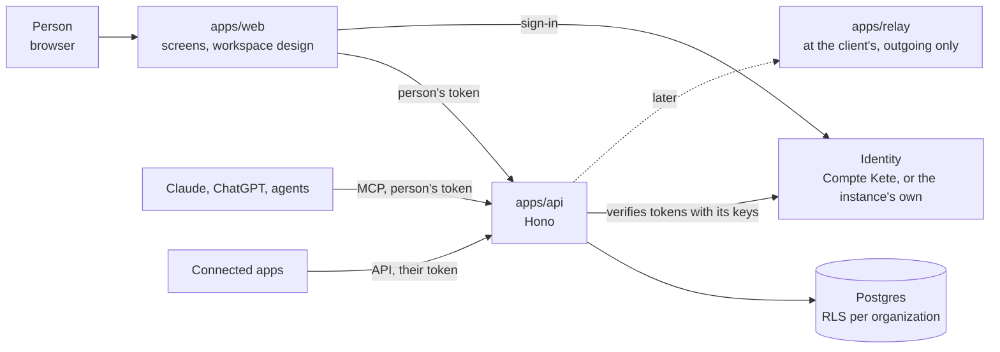

# Architecture

Kete Enterprise is the chain of a company: what exists between its tools (doctrine D-028). This
document says how it is built; `docs/ROADMAP.md` says in which order.

## The pieces



- **One door: the API** (D-029). The screens, the MCP gateway, agents and connected apps all go
  through it, with a person's token; it owns the database. Nothing reaches the database another way.
- **The screens hold no data.** They sign the person in with the identity, keep her token
  server-side only, and call the API on her behalf: never more than her rights.
- **The identity** is the Compte Kete on Kete's shared instance; an autonomous instance has its own
  (D-011, D-028). The API only needs its issuer address and published keys.
- **The organization is the boundary** (D-041): every table carries `organization_id` and its RLS
  policy in the same migration; the API connects with a role that cannot bypass it.

## Inside the API

```
apps/api/src/
  app.ts                 the routes: /health, /.well-known/kete, /v1/* behind a person's token
  platform/              the wiring, no business rule: env, database, identity, manifest
  features/<feature>/    one vertical slice each: domain, commands, queries, routes, README
db/migrations.ts         every table with its row-level security, in order
```

Features (in order, `docs/ROADMAP.md`): `structure`, `rights`, `registry`, `decisions`, `gateway`,
`agents`, `compliance`. A feature is used only through its `index.ts`.

kete-core's building blocks do the common work (D-030): `@kete/tenancy` (organization transactions),
`@kete/commands` (named gestures, journal, chain of agents), `@kete/drafts` and
`@kete/capabilities` (the AI prepares, a person decides), `@kete/sdk` (manifest, health, outbox),
`@kete/auth` (tokens), `@kete/jobs` (the worker), `@kete/design` (screens), `@kete/work` (holdings
and the relay, spec 087), `@kete/policies` (one policy engine at the gesture, on Cedar — the
agents' rules and the circuits are its policies, spec 088), `@kete/threads` and `@kete/channels`
(a thread per object, the router, mail bridged, spec 089).

## The threads (spec 099)

The enterprise talks in its threads (doctrine D-061). `@kete/threads` keeps every message once —
the thread of an object, a group, a direct one, her thread « Kete » —, `@kete/conversation` draws
them on the canvas v6.2, and the API (`features/messages`) adds what a center needs around them:

- **Files and voice notes** go to the storage (`platform/storage.ts`: S3 when `KETE_STORAGE_*` is
  set, a disk otherwise), 100 MB at most, served to the thread's members only; a voice note is
  transcribed after, by the organization's model, metered.
- **Pages**: a thread opens at her first unread message (80 around it), older pages on demand.
- **Live**: every change reaches her screens by the stream (`/api/fils/flux`); « écrit… » is told,
  never kept.
- **The phone** rings only for a message she has not seen in three minutes, once, by her level
  (all, mentions, none) — the worker's job `ring-threads`.
- **Kete in a thread** answers « seulement pour vous » when it read beyond the thread and others
  read it; she may share the answer. Its turn is kept with its steps (`thread_runs`).
- **Elsewhere**: a WhatsApp or Telegram export, or a mail, is imported once (each message keyed);
  two threads merge by the holder of the first.
- **An agent** is never a holder: a task given to it is held by the person who gave it, the agent
  its delegate, and the result returns to her (`holding.returned`).

```mermaid
flowchart LR
  F[The composer] -->|text, @, #, files, voice| A[API · messages]
  A --> T[(kete_messages and their marks)]
  A --> S[(Storage · S3 or disk)]
  A -->|@Kete| K[Kete] -->|only for her when it read beyond| T
  T -->|announce| L[Stream · her screens]
  T -->|unseen 3 min| P[Push · her phone]
  M[Mail, WhatsApp, Telegram] -->|reply headers → address → contact → model → à classer| A
  I[An export .txt, .json, .eml] -->|once per message| A
```

## Where it runs

- Any Postgres 16 or more (with pgvector) and any S3-compatible storage, or a disk for a single
  server; Docker Compose
  (`deploy/`) or Coolify; never a call to Kete to work (D-029).
- Two images: `apps/api` (it applies its migrations at start-up) and `apps/web`.
- Kete's own instances use the Neon project `kete-enterprise` (`docs/OPERATIONS.md`).
