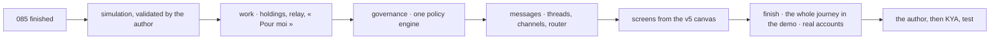

# Roadmap

One Spec Kit feature at a time, each delivered and proven before the next (constitution I and II).
KYA is the first client (doctrine D-025): each proof is obtained on KYA's real organization.

| Spec                                | Delivers                                                                                                                                                                                                                                                               | Proof                                                                                        |
| ----------------------------------- | ---------------------------------------------------------------------------------------------------------------------------------------------------------------------------------------------------------------------------------------------------------------------- | -------------------------------------------------------------------------------------------- |
| `001-foundation`                    | The repository, CI, the API (`/health`, manifest with its identity card, a person's token), the screens signed in through the Compte Kete, Docker Compose, staging                                                                                                     | A person signs in on staging and sees her organization                                       |
| `002-structure`                     | Legal entities, units with configurable types, positions, dated assignments, relationships (D-041)                                                                                                                                                                     | KYA's organization chart entered, dated                                                      |
| `003-rights`                        | Roles with a scope (subtree, country, project), each resource's owner and scope                                                                                                                                                                                        | A branch manager sees his branch only                                                        |
| `004-registry`                      | The inventory of apps, skills, MCP and agents from their identity card; submission from Claude; promotion by tiers                                                                                                                                                     | KYA's apps inventoried, those without an owner flagged                                       |
| `005-decisions`                     | Approval circuits described as data, the Inbox                                                                                                                                                                                                                         | A request approved by the right person, by threshold                                         |
| `006-gateway`                       | One MCP address per person, limited to her scope                                                                                                                                                                                                                       | Claude acts for a person, within her scope                                                   |
| `007-agents`                        | Agents with a job description, woken by events, narrowing delegations, a budget of drafts (D-039); the first one watches the controls (level 1)                                                                                                                        | The agent flags a failing control                                                            |
| `008-compliance`                    | Frameworks, requirements, shared controls, evidence from the journals, documents, audits, findings, corrective actions, certificates (D-040)                                                                                                                           | A pilot framework's controls and their evidence                                              |
| `010-foundation-for-business-tools` | People found by e-mail and imported at once, personal links for people without an account, e-mails with their gesture and the test outbox, modules per organization, the Administration split from the space, demo organizations and « view as », the KYA demo profile | A technician without an account opens his link; an administrator views a demo person's space |
| `011-surveys`                       | Questionnaires, campaigns sent by personal link, answers, results on 100 with anonymity, results feeding indicators                                                                                                                                                    | KYA's quarterly satisfaction survey answered by link                                         |
| `012-performance`                   | Indicators with six attributes on three levels, grids per position (KYA-KPI-01), objectives, protocols, the quarterly review up to the performance factors                                                                                                             | A quarter closed, reviewed and signed, factors out                                           |
| `013-meetings`                      | Meetings and their agendas drawn from the gaps, decision records, numbered decision notes, the action register, ISO 9001 evidence                                                                                                                                      | A Codir decides on a red indicator, the action is tracked                                    |

| `014-workspace-assistant` | The home page, the morning briefing, the assistant acting for the person with her tools, resources, the use of models and its budget | Abla's morning, read and explained by her assistant |
| `015-app-readings` | Readings of indicators sent by connected apps, taken into reviews | Support's SLA reading in Abla's review |
| `016-page-slots` | Every page in the same slots, every view in several formats | The organization as a chart, a tree and a table |
| `017-drafts-and-chat` | Level-3 drafts decided by people; the streamed chat with its conversations | A measure prepared by the assistant, validated by management control |
| `018-app-integration` | The apps' tools in the central chat; the apps' tasks in To do | A ticket opened from the central chat; « Rétablir » in To do |

## The complete system (decided 2026-10-03)

Each spec is delivered and proven before the next. What exists is reused: the libraries and
standards named in kete-core's roadmap (phase 6). Specs 022 to 025 are the center's side of the app
contract (kete-core spec 049): what an app declares, Kete Enterprise grants, answers and routes.

| Spec                           | Delivers                                                                                                                                                                                                                                                      | Proof                                                                                                   |
| ------------------------------ | ------------------------------------------------------------------------------------------------------------------------------------------------------------------------------------------------------------------------------------------------------------- | ------------------------------------------------------------------------------------------------------- |
| `019-forms-and-modes`          | Every form on its page or in a dialog, never beside a list; dark, light or automatic                                                                                                                                                                          | No page holds a list and a form; the person's mode is kept                                              |
| `020-card-discovery`           | The registry reads an app's tools and data sets from its card; an end-to-end MCP test                                                                                                                                                                         | Support's tools reach the central chat in CI                                                            |
| `021-app-factory`              | A person asks for an app; IT approves; the factory creates it, a coding agent codes it in a sandbox, a pull request comes back                                                                                                                                | An app asked from the space runs on staging, registered                                                 |
| `022-app-permissions`          | An app's permissions read from its card, ticked per role in Administration › Rights, granted to positions; the app reads a person's grants                                                                                                                    | « Manage the queues » granted to the head of after-sales service changes what Support lets him do       |
| `023-directory-and-approvals`  | The organization read by apps (units, positions, managers); apps ask the decisions engine for an approval, interim included                                                                                                                                   | A purchase asked in an app is approved by the right manager, in the Inbox                               |
| `024-agent-mandate`            | Agents call apps with a mandate (« agent X for person Y »), never more than her; the app journals both                                                                                                                                                        | An agent's call in Support is journaled as the agent, for the person                                    |
| `025-app-events`               | Apps' events received, authenticated by the app's own token; routed to agents, briefings and notifications; secret data kept out of models                                                                                                                    | « A critical ticket opened » reaches the morning briefing                                               |
| `026-personal-ai`              | Each person brings her own AI key: her assistant and agents run on her tokens, by the organization's policy (allowed, required, off)                                                                                                                          | Kofi's assistant answers on his own key; the organization's budget is untouched                         |
| `026b-pay-with`                | « Pay with » in the chat: the organization, her key, or her own subscription signed in on her own machine                                                                                                                                                     | Kofi's question answered on his own subscription; the organization's budget is untouched                |
| `027-chat`                     | The chat of the current era: attachments, side canvas, citations, mentions, commands, dictation                                                                                                                                                               | A client's PDF read and answered in a final document                                                    |
| `028-knowledge`                | The company's library (ISO procedures, notes, templates, records), searched with citations, by rights                                                                                                                                                         | « What does our procedure say about … » answered with its source                                        |
| `029-memory-and-schedules`     | The assistant's memory, scheduled tasks, the briefing sent in the morning                                                                                                                                                                                     | « Every Monday at 8 » runs and lands in To do                                                           |
| `029b-app-views`               | The team's apps' views in the chat (MCP Apps): a table, a record, a form, a draft decided in its view                                                                                                                                                         | Support's tickets shown in the chat; a draft validated by the person in its view, never by the model    |
| `030-notifications-and-search` | Notifications (in the app, Web Push), global search                                                                                                                                                                                                           | A decision waiting reaches its person's phone                                                           |
| `031-skills-and-data`          | Skills as folders, created from a conversation, evaluated, shared; team data sets                                                                                                                                                                             | A skill kept from a conversation, then promoted                                                         |
| `032-forms`                    | Simple collections with a circuit, as data sets; a recurring form becomes an app                                                                                                                                                                              | A collection answered by link, its data in a dashboard                                                  |
| `033-dashboards`               | Dashboards composed by each person or prepared by the assistant                                                                                                                                                                                               | « Make me an SAV dashboard », validated, shared                                                         |
| `034-dossiers`                 | Shared spaces per subject: conversations, documents, drafts, data                                                                                                                                                                                             | The ISO audit dossier built by a team                                                                   |
| `035-meeting-records`          | A meeting's audio transcribed, its record prepared as a draft                                                                                                                                                                                                 | The weekly review's record prepared, decisions into actions                                             |
| `036-agents`                   | Tasks given to agents in the background, delegation between agents, supervision, kill switch                                                                                                                                                                  | The audit agent asks the SAV agent; the person decides                                                  |
| `037-production`               | KYA's own domain and server, backups, monitoring, real e-mails, WhatsApp                                                                                                                                                                                      | KYA works on production                                                                                 |
| `038-documents`                | The organization's Word templates filled in Word or PDF, by the assistant or by hand; the canvas as PDF; every file read (Office, scans)                                                                                                                      | Mme Owusu's intervention letter produced from KYA's template, in PDF                                    |
| `039-mcp-2026`                 | MCP 2026-07-28: the gateway and the apps on the SDK v2; a copilot's draft decided by the person in her copilot                                                                                                                                                | Claude prepares an action, the person validates it in Claude                                            |
| `046-shell-and-today`          | The Kete 2026 shell: five places, Ctrl K to go, find or ask, the phone's tab bar; « Aujourd'hui »: things to do, pinned views, what agents did                                                                                                                | Abla's morning settled from « Aujourd'hui »; a question asked from Ctrl K answered with its sources     |
| `047-todo`                     | « À faire » beside the list: J/K, A/R/C; a decision with its sourced analysis, its steps, its discussion                                                                                                                                                      | A purchase decided from « À faire » with the assistant's sourced analysis                               |
| `048-assistant-beside`         | The assistant beside every page, knowing what it shows; Ctrl K answers in place; an answer pinned or asked every Monday                                                                                                                                       | « Quels tickets critiques ? » answered from Ctrl K, pinned on « Aujourd'hui »                           |
| `049-sidebar`                  | The sidebar each person arranges: places hidden, shortcuts pinned from where things live, sections named and ordered, kept with her account                                                                                                                   | Awa pins her SAV dashboard and her audit dossier, hides Mon équipe; her phone shows the same sidebar    |
| `050-dashboards-deep`          | Dashboards as personal as their reader wants: a grid she arranges, period and value filters, a click that filters the board, goals and alerts, notes and app views, her own version of a shared board, versions, the assistant changing a board by a sentence | « Ajoute les pièces en rupture » changes the SAV board; Kofi makes his version of the direction's board |
| `051-routines`                 | One « Routines » page: at a set time, when an app signals, on watch; each understood from a sentence, its plan shown before it starts, tried once, its runs kept                                                                                              | « Chaque vendredi à 16 h, résume les tickets » planned, tried, then running                             |
| `052-agent-record`             | An agent's autonomy per kind of task, its week's record, an agent created from a sentence                                                                                                                                                                     | The SAV agent acts alone on reminders, prepares letters, and its week shows what was kept               |
| `053-chat-plan`                | The chat shows its plan before acting, its sources on hover, what to do next with an answer, and asks if it helped                                                                                                                                            | A purchase analysis planned, cited, then kept as a Monday routine                                       |
| `054-ai-governance`            | What the organization allows, spends and has done with AI: policies, budgets and use per team, the audit journal                                                                                                                                              | The SAV budget seen against its use; the journal exported                                               |
| `055-notes`                    | « Noter » from any page: a note kept in « Mon carnet », understood, a reminder filed in « À faire » when it names a moment; her assistant reads her notes                                                                                                     | « Réunion demain 10 h avec Kofi » kept, its reminder in « À faire », undone in one gesture              |
| `056-how`                      | « Comment ? » beside what an agent did: who asked, each step with the right and the level it used, its sources, what it did alone, its rights                                                                                                                 | The SAV agent's reminder explained step by step                                                         |
| `057-assistant-exchanges`      | A person's assistant asks a colleague's: answered alone within what she allows, passed to her otherwise                                                                                                                                                       | Kofi's assistant tells Awa's when he is busy; another question waits for Kofi                           |
| `058-today-session`            | « Aujourd'hui » as a session, one subject at a time, and « Pendant ce temps », what agents and apps are doing                                                                                                                                                 | A morning settled subject by subject                                                                    |
| `059-field`                    | « Terrain »: the day on a phone outdoors — the next dated subject in large type, a report dictated and read back, large targets, « Plein soleil »                                                                                                             | Afi dictates her intervention report, reads it back and keeps it                                        |

## The center in three places (decided 2026-10-13)

Doctrine D-042 to D-046. The center keeps three places named by what a person does there —
**Décider**, **Demander**, **Déléguer** — with the apps and the Administration behind; a business
tool is an app, never a module of the center; what makes Kete different is the layer of trust
(mandate, drafts, rules, registry, « Comment ? »). The screens this plan is built against are in
[`docs/design/screens-2026.md`](design/screens-2026.md).

It is a recast of the screens **on the existing code**, not a rewrite: the pieces already delivered
(the session of « Aujourd'hui », « À faire », the chat on assistant-ui, the views of apps, « Comment ? »,
agents' tasks, routines, the registry, the circuits) are moved and completed. No new capability
enters the center before these close. The tests stay at today's level (the API's tests; the author's
choice of 2026-10-12).

### State before it starts

- Specs 001 to 059 are merged. `037-production` has its first part only (the cost of models): the
  domain, the server, backups, monitoring, real e-mails and WhatsApp remain.
- 35 domains, 60 screens, a sidebar of about twenty places; performance, surveys, meetings and
  compliance live inside the center.
- No real use yet: nothing below is proven by a person until a manager at KYA tries it.

### Specs, in order

The steps are those of the plan shared with `kete-core` (its roadmap, phase 7: A1, B1 to B7).

| Step | Spec                                              | Delivers                                                                                                                                                                                                                                                                      | Proof                                                                   | Needs from `kete-core` |
| ---- | ------------------------------------------------- | ----------------------------------------------------------------------------------------------------------------------------------------------------------------------------------------------------------------------------------------------------------------------------- | ----------------------------------------------------------------------- | ---------------------- |
| A2   | `060-structure` (done)                            | The reference of screens, this plan; then the product run as it is, pictures of « Aujourd'hui », « À faire », the assistant and the agents, and the list of gaps against the reference                                                                                        | The author has the list                                                 | —                      |
| C1   | `061-frame` (first part done)                     | The frame: three places, Ctrl K on top, the phone's tabs, notifications, personal settings, the states offline, error and limit reached                                                                                                                                       | Every page is reached through the new frame                             | —                      |
| C2   | `062-decide` (first part done)                    | Décider: « Aujourd'hui » and « À faire » merged, the morning as a pile of decisions with their evidence, « Pendant ce temps », a decision taken by a reply on WhatsApp or Telegram                                                                                            | The morning of the after-sales manager is settled from end to end       | B1                     |
| C3   | `063-answers` (first part done)                   | Demander: an answer that is a tool (a table to sort, filter and act on), its steps, its sources, the gestures under it; the input with its modes, mentions, commands and a queue while an agent works                                                                         | A question returns a table a person acts on                             | —                      |
| C4   | `064-files-and-pieces` (first part done)          | The files and media of a thread listed once; the viewer (PDF, document, spreadsheet, images in focused and canvas view); the review of changes, for a document as for code; versions                                                                                          | A cited source opens its file at the right line                         | —                      |
| C5   | `065-projects-and-colleagues` (first part done)   | Projects (threads, files, instructions, memory she can read and erase), threads with several people, **a request to a colleague with its states** (D-044), sharing, long research in the background, voice                                                                    | Two people and an agent work in one thread; a request comes back signed | B4                     |
| C6   | `066-agents-at-work` (first part done)            | Déléguer: my agents **private or shared** (D-044), their card, the six states everywhere, the run seen live (pause, write to it, take over), hand-overs shown in the thread; agents and routines moved onto the runtime                                                       | An agent is paused, redirected and taken over                           | B3                     |
| C7   | `067-my-desk` (first part done)                   | An agent from a sentence with its dry run on last week, routines, the factory's agent seen at work (file, terminal, preview, tests), **« Mon accueil »** with its safeguards                                                                                                  | An agent created from a sentence runs after its dry run                 | B3                     |
| C8   | `068-rules-and-registry` (first part done)        | Administration in six entries; **rules** in eight families, each tried on last month before it is switched on; the **registry** (owner, review, duplicates, a leaver's agents handed on); **evidence**; an organization imported from a spreadsheet or described in sentences | A rule refuses a gesture and the journal names it                       | B3, B4                 |
| C9   | `069-apps-and-connectors` (first part done)       | Apps: the list and what the center receives from each, « ask for an app », connectors through MCP — Frappe first (read), then e-mail and calendar                                                                                                                             | A purchase request made in Frappe lands in Décider                      | —                      |
| C10  | `070-lighter-center` (the menu and « Apps » done) | Performance, surveys, meetings and compliance leave the center and become apps on the app contract                                                                                                                                                                            | The center has its three places and nothing else                        | B7                     |
| C11  | `071-twelve-scenarios` (Kete played, not the two) | Twelve scenarios played side by side with ChatGPT and Claude, each one scored, the gaps listed                                                                                                                                                                                | The list of gaps, scenario by scenario                                  | —                      |
| D2   | `072-shared-instance`                             | The shared instance in production on Kete's own server, in the database's region; offers and limits applied; a space exported whole                                                                                                                                           | A demonstration organization signs up alone and reaches its limit       | B5, B6                 |
| D3   | `037-production` (continued)                      | KYA's own instance: its domain, its server, backups with a restore tried once, monitoring, real e-mails, WhatsApp                                                                                                                                                             | KYA works on production                                                 | B1, B2                 |

The fleet (D1: creating a space, offers, health) is built in Kete Cockpit (doctrine D-027).

### Built on (open source)

| Library                                       | Where                                               | Status                            |
| --------------------------------------------- | --------------------------------------------------- | --------------------------------- |
| assistant-ui, AI SDK, the MCP SDK, mcp-ui     | The chat, the gateway, the views of apps            | In use                            |
| ECharts, react-grid-layout, croner, cmdk      | Dashboards, routines' hours, Ctrl K                 | In use                            |
| Mastra, through `@kete/agents`                | C6: the agents' runtime (`kete-core` decision 0010) | Used: tasks run on it (spec 066)  |
| TanStack Table                                | C3: answers as tables                               | In use                            |
| PDF.js                                        | C4: the viewer                                      | Decided                           |
| CodeMirror 6 (merge view), jsdiff, Tiptap     | C4: the review of changes, editing a document       | Evaluated against what exists     |
| xterm.js                                      | C7: the terminal of an agent that codes             | Evaluated                         |
| Existing MCP servers (Frappe, mail, calendar) | C9: connectors, rather than writing them            | To be checked before any is taken |
| A2A                                           | C5 and C6: exchanges between assistants and agents  | Evaluated against spec 057        |

A library's licence is checked before it is adopted.

### Not done

A new business tool inside the center; a second interface stack (CopilotKit, AG-UI); a screen of
« objectives » (a goal may be attached to an agent — its own screen waits for real use).

### What depends on the author

A WhatsApp number and a Telegram bot for tests (before C2); a contact at KYA who tries C2 for real;
the offers and their limits, the hosting account, the filing with the data-protection authority
(before D2).

New apps, each in its own repository, created by the factory: `kete-fieldwork`, `kete-assets`,
`kete-inventory`, `kete-projects`, `kete-lab`, `kete-correspondence`; then Frappe's flows, one by
one (inventory, classification, recoding, history, parallel run, Frappe form switched off).

## References, and four apps behind the center (decided 2026-10-13)

### Objective

The center holds the three references every app cites — **people**, **third parties**,
**projects** — and four apps hold the facts: **Kete Finance**, **Kete Team**, **Kete Commitments**
and **Support** (doctrine D-047 to D-049; product names are in English, the doctrine calls them
Gestion, Équipe, Engagements, Support). A project is one object: where a job is discussed is where
its money, its team, its contract and its tickets are seen. Every fact of money carries its
project.

The model, each app and its screens are in [`docs/design/apps-2026-10.md`](design/apps-2026-10.md).

### Specs, in order

`kete-core` carries what the apps share (its roadmap, phase 8: E1 to E4). The apps each have their
own repository, created from the template; their steps are listed here because they close on the
center.

| Step | Where                                       | Delivers                                                                                                                                                                   | Proof                                                                 | Needs  |
| ---- | ------------------------------------------- | -------------------------------------------------------------------------------------------------------------------------------------------------------------------------- | --------------------------------------------------------------------- | ------ |
| F1   | `073-tiers` (done)                          | Third parties: one record per company or person outside, its roles (client, supplier, funder), duplicates proposed and merged, what each app knows of it; read by the apps | Two records of one company are merged, and every app follows          | —      |
| F2   | `074-projects` (done)                       | Projects: one object — its thread, files and instructions; its team; its budget by post; its phases — a second axis of rights; read by the apps                            | A project born from a sentence shows its team, its budget, its thread | F1     |
| F3   | `075-circuits-completed` (done, first part) | Circuits: send back for correction, a person informed, steps in parallel, escalation after a delay, a step decided by the project's lead                                   | A request sent back is corrected and decided, without a new one       | F2     |
| F4   | `076-money-by-project` (done)               | The facts of money the apps send, kept by project: received, committed, spent, available; the three states of money; funds of one project paying another                   | A project's available funds follow what Kete Finance sends            | F2, E3 |
| F5   | `077-phone` (done, first part)              | WhatsApp and Telegram in the center: what waits for her arrives there, she decides by a reply                                                                              | A decision is taken by a reply on a phone                             | F3     |
| G1   | `kete-africa/kete-finance` (built)          | Kete Finance, part 1 — sales: quotes with their cost, invoices, receipts of payment, delivered and not invoiced; a won quote opens its project                             | A won quote becomes a project with its budget                         | F2, E2 |
| G2   | `kete-africa/kete-finance` (built)          | Kete Finance, part 2 — purchases and expenses: requests with their project and post, expense notes read from a photo, advances to justify, the memory of prices            | A request beyond its post goes up the circuit                         | G1, F3 |
| G3   | `kete-africa/kete-finance` (built)          | Kete Finance, part 3 — treasury: accounts, movements, the three states of money, funds by project, the daily closing of a till                                             | « Really available » is the bank less reserved and committed          | G2, F4 |
| H1   | `kete-africa/kete-team` (built)             | Kete Team: leave and absences, authorisations that expire, time by project in one answer a week, advances on salary, the month's pay elements                              | A person without a valid authorisation cannot be assigned             | F2     |
| I1   | `kete-africa/kete-commitments` (built)      | Kete Commitments: contracts read into dates and obligations with the passage cited, retentions and bonds to recover, a funder's agreement as rules of spending             | A funder's clause refuses a purchase in Kete Finance                  | G2     |
| J1   | `kete-africa/kete-helpdesk` (built)         | Support: a ticket knows what the client bought and who pays — warranty, contract, billable; its cost goes to its project; a billable one prepares its invoice              | A billable intervention prepares an invoice in Kete Finance           | G1     |

### Not done

General accounting, payroll, stock; executing a payment; a country's legal calendar maintained by
Kete; shared costs spread over projects (they stay in « Fonctionnement »). Enquêtes joins the
center's forms and Réunions becomes a thread with several people (D-048): neither is an app.

### What depends on the author

A real bank statement, real receipts and a real contract read by a real model: the reading on
which treasury and commitments rest is unproven. A WhatsApp number and a Telegram bot for F5.

## The unification (decided 2026-10-15)

Doctrine D-056 to D-058; decision [0002](decisions/0002-modules-of-the-living-model.md); kete-core
phase 10. The center's features gather into one living model — the journal, the thread of each
object, the **holding** (every thing in progress with its holder, never nobody), the gesture and
the **policy** — and the screen opens on **« Pour moi »**, with the conversation in the middle and
the state beside it. The places of the canvas 3.1 (Décider, Demander) become « Pour moi » and the
thread « Kete ». This replaces the order of « The method, time and memory » below: its screens are
redone after the model, from a validated v5 canvas.

| Step | Spec                                | Delivers                                                                                                                                                                                                                                                                                                                                                                                                                                                                             | Proof                                                                                                                                          |
| ---- | ----------------------------------- | ------------------------------------------------------------------------------------------------------------------------------------------------------------------------------------------------------------------------------------------------------------------------------------------------------------------------------------------------------------------------------------------------------------------------------------------------------------------------------------ | ---------------------------------------------------------------------------------------------------------------------------------------------- |
| 0    | `085-canvas-frame`                  | The frame and Kete Intelligence (drawer, page « Demander ») on kete-core's packages; the old chat thread removed, none of its gestures lost                                                                                                                                                                                                                                                                                                                                          | Side by side with the canvas, computer and phone, light and dark                                                                               |
| SIM  | —                                   | A complete simulation of the system (HTML, CSS, JS), validated by the author before any code below                                                                                                                                                                                                                                                                                                                                                                                   | The author walks the whole flow and says it holds                                                                                              |
| W    | `087-holdings`                      | `work`: holdings from requests, to do, meeting actions, circuit steps, drafts, agent tasks; the relay with deputies and absences; « Pour moi »                                                                                                                                                                                                                                                                                                                                       | No holding without a holder; an absence moves its holdings the same day                                                                        |
| G    | `088-policies`                      | `governance`: one policy engine at the gesture; circuits and agents' rules melt into it; compliance points to it; the six missing policies                                                                                                                                                                                                                                                                                                                                           | The same gesture by a person and by an agent goes through the same policy, journaled                                                           |
| M    | `089-threads-and-channels`          | `messages`: a thread per object, the thread « Kete », exchanges and meetings as threads; WhatsApp and IMAP inbound; the router; cards on WhatsApp                                                                                                                                                                                                                                                                                                                                    | A client's message lands in its project's thread with a holder; a card settled anywhere                                                        |
| S    | `090-screens-v5`                    | « Pour moi », the thread with its state, Planifier, Mon tableau, an agent's settings, the phone — each compared with the validated v5 canvas                                                                                                                                                                                                                                                                                                                                         | Screenshots beside the canvas                                                                                                                  |
| A6   | `092-settings`                      | « Réglages » (kete-core specs 115 to 117): her preferences in the Compte Kete, the center's settings and each unit's (a subsidiary, a site), journaled                                                                                                                                                                                                                                                                                                                               | KYA Ghana's currency wins at the site of Accra; a command there reads it                                                                       |
| C4   | `093-tools`                         | « Outils » (kete-core spec 124): the organization's own tools, OpenAPI or remote MCP, imported for its agents — a read alone, an act as a draft, a destruction confirmed                                                                                                                                                                                                                                                                                                             | Through the gateway, a CRM's act reaches it only once she decided its draft                                                                    |
| C4   | `094-agent-abilities`               | Agents beyond Kete (kete-core spec 129): the web and a computer of their own when the organization turns them on, a researcher for agents' tasks, answers said aloud — under the policies                                                                                                                                                                                                                                                                                            | After a page was read, a gesture that lands at once waits for her                                                                              |
| A4+  | `098-threads-at-the-center`         | Threads people live in (the author's test of 2026-10-21): live, unread, members, mentions, files, moves, actions with holder and due day, the object's cards, @Kete, internal or to the client through the policies, WhatsApp, a thread born with each object of the center and the apps, Planifier in Outlook, the six policies as forms                                                                                                                                            | A client's answer leaves only « au client », after the approval a policy asks                                                                  |
| A7   | `099-the-enterprise-talks-here`     | The threads at today's level (doctrine D-061, kete-core spec 140, canvas v6.2): `@kete/conversation` and the one composer, voice notes kept and transcribed, photos, « # » citations in their state of now, reactions, pins, a message taken back, pages from the first unread, « Infos du fil », typing, a phone rung after three minutes unseen, Kete's answer « seulement pour vous », WhatsApp and Telegram exports imported, threads merged, an agent a delegate never a holder | Every gesture of the old screen kept; a voice note served to members only; an import twice adds nothing                                        |
| A7b  | `099-the-enterprise-talks-here` (B) | Kete, the door (FR-007 to FR-011): the page « Kete » is her thread « Kete », the drawer writes into it with the page; Kete's turn streamed with its steps and « Arrêter »; a set of gestures from what is said, confirmed in one tap or corrected; a rule become a policy simulated over thirty days; parts handed to her agents; « Inviter quelqu'un »                                                                                                                              | Nothing exists before her « oui »; a group's orders are answered to their author alone                                                         |
| A7c  | `099-the-enterprise-talks-here` (C) | Agents as colleagues (FR-013 to FR-017): « Mes agents » by state, each agent's thread where she gives it work by talking, its answers with their steps, its requests « Autoriser une fois / Toujours… / Refuser » (expiring when its routine asked), its job description at work (take-on, computer, return, routine), an agent from one sentence on trial                                                                                                                           | A holding it takes on stays its person's; signing and paying never become « Toujours »                                                         |
| A7d  | `099-the-enterprise-talks-here` (D) | Mail as decided (FR-018): a shared box read whole, a personal one only for what touches the objects, its « Kete » folder and its Sent folder by the same rule; « Mails et conversations » with what each box reads, its week and the routing steps' counts; a mail cleaned, its original one tap away; imports from the settings                                                                                                                                                     | A friend's mail never enters a thread; a mail sent from Outlook to a client does, as hers                                                      |
| A7e  | `099-the-enterprise-talks-here` (E) | The screens beside the canvas: `pnpm --filter @kete-enterprise/web screens` starts the demo, says cases A and B for real and shoots the threads, Kete, the agents and the mails on a computer and a phone, light and dark, with the same v6.2 screens; fixed from them: the singular of « 1 geste », the agent's state and « Réglages » in its head, one state for the list and its thread                                                                                           | Each pair read side by side                                                                                                                    |
| A8a  | `100-objects-at-the-center`         | D-062, R1 · R2 · R4 · R15 (kete-core spec 142, ADR 0014): one index of every object — the center's references by triggers, the apps' objects said with their token in their declared kinds —, named links, sight by the rights she already has, places and assets with their thread, « # », the search and the gateway's `objects_find` and `object_read`, « Équipements »                                                                                                           | An asset born of a project shows « produit par », a ticket shows on it as « concernée par »; each person sees exactly what her rights give her |
| A8b  | `101-one-event-path`                | D-062, R11 (kete-core spec 143, ADR 0017): one event log — an app's events naming their object, the index's births and changes of state —, agents' subscriptions as data, a dispatcher acting once per consumer with retries and failures shown, the object's thread told, « Son histoire » live on an asset's page                                                                                                                                                                  | An asset reaching « En alerte » gives the agent that follows it one task in its thread; Support's event about it is said there once            |
| A8c  | `102-the-measure`                   | D-062, R2 · R4 · R7 · R11 · R17 (kete-core spec 144, ADR 0015): indicators name their source — the center's holdings, money and assets, an app's data set summed up at home, an app's figure, or typed —; live readings with their provenance, missing never zero; red for the organization gives its owner a corrective holding and an event; freezes; a review's line from its source; « Indicateurs »                                                                             | The fleet's availability read at 75 % turns red and its owner holds « action corrective »; a review's line takes 66,7 % with its proof         |
| A8d  | `103-components`                    | D-062, R16 · R22 (kete-core spec 145, ADR 0016): `view.v1` configurations in layers — Kete's default, the organization's, a position's, her own — every version kept; each card read with her rights; Kete's `view_read` and `view_change`; team tables and forms on the one engine; « Pilotage »                                                                                                                                                                                    | The steering board shows the fleet, what waits and the money; her version wins over the organization's and goes back in one gesture            |
| A8e  | `104-agents-sources`                | D-062, R5 (kete-core spec 146, ADR 0018): an agent receives only its sources' tools — the gateway's gestures, Kete's own sets —, knows the object its task is about, and comes from a catalogue an administrator opens and each person takes                                                                                                                                                                                                                                         | « Agent Parc » taken by Kossi wakes when an asset turns to alert, its task in the asset's thread, knowing the asset and its project            |
| A8f  | `105-one-connection`                | D-062, R8 · R17 (kete-core spec 147, ADR 0019): each tool seen once with its three uses and health; act granted tool by tool, never alone; a signed webhook per connection onto the event path; « Connexions »                                                                                                                                                                                                                                                                       | The CRM reads at once, acts only on the tool an administrator granted; its signed « facture échue » wakes the agent that follows it            |
| F    | `091-whole-journey`                 | The whole journey as an end-to-end test in the demo, the fluidity figures computed, the real accounts plugged (WhatsApp Business, IMAP, the model's key)                                                                                                                                                                                                                                                                                                                             | The test passes on the demo; production answers                                                                                                |

At the end, the author, then a person at KYA, use it.

## The method, time and memory (decided 2026-10-13, evening)

Doctrine D-050 to D-054. The center gains a fourth place, **Planifier**; Décider carries the rhythm
of the day (morning, evening, week); dashboards, routines, summaries and notes become one entry,
**Mon tableau**; agents show their job description and know-how its lessons; the phone is native.
The screens are in [`docs/design/screens-2026.md`](design/screens-2026.md), section « The method,
time and memory ».

What the center and the apps share is built first in `kete-core` (its roadmap, phase 9: L1 to L8):
the app manifest and the contracts, `@kete/shell`, `@kete/intelligence` (extracted from this
repository's chat, which then consumes it), `@kete/time`, `@kete/metrics` and `@kete/boards`, the
proposal sets and the voice, the lifecycle of resources, the phone's screens. The center is then
rebuilt on them, without a second implementation of anything.

| Step | Spec                  | Delivers                                                                                                                                                                                                     | Proof                                                                               |
| ---- | --------------------- | ------------------------------------------------------------------------------------------------------------------------------------------------------------------------------------------------------------ | ----------------------------------------------------------------------------------- |
| C1   | `082-frame-on-shell`  | The frame on `@kete/shell`: the places (Planifier with C12), the drawer beside the page, « Noter » everywhere, the phone's tabs; the drawer's stream on `@kete/intelligence` next                            | The same frame as a generated app; no page `/demander`                              |
| C1   | `085-canvas-frame`    | The frame, Kete Intelligence beside every page and « Demander » exactly as the validated canvas draws them, from `@kete/shell` and `@kete/intelligence`; the old chat drawer gone, none of its gestures lost | Side by side with the canvas on a computer and a phone, light and dark              |
| C2   | `083-evening-closure` | Décider's moments: the evening closure written or spoken (done); the morning's pile on a phone, WhatsApp, the week's review next                                                                             | A spoken note becomes ticked proposals; nothing changes without the gesture; undone |
| C12  | `079-plan`            | Planifier: my view, my team, the organization by rights; dated facts from the apps; conflicts said (blocks proposed and an external agenda next)                                                             | A leave and a delivery the same day make a conflict, settled in one gesture         |
| C13  | `080-my-board`        | Mon tableau: En direct, Résumés, Carnet — dashboards (050), routines (051) and notes (055) merged; a summary frozen and indexed by choice                                                                    | An indexed summary is cited by the assistant; taken out of the index, it is not     |
| C6   | `066-agents-at-work`  | An agent's job description, its six states, « Pendant ce temps », autonomy earned by proofs                                                                                                                  | An agent's autonomy is proposed after its proofs and withdrawn in one gesture       |
| C7   | `067-my-desk` (cont.) | Know-how: a skill's lessons from use, its tests, its versions, its promotion by tiers with a review; the same for a factory's app                                                                            | A kept lesson becomes a test; a version breaking an old case is refused             |
| C14  | `081-project-memory`  | The project's Mémoire and Calendrier; « Terrain » (059) on the shared phone screens                                                                                                                          | A dictated report is read back, validated, and draws its drafts                     |

C3 to C5 and C8 to C11, D2 and D3 keep their place above. Not done: a new business tool inside the
center; a query builder for people; surveillance of time (D-051).

## Later, when a real need appears

The internal chat and knowledge (`assistant`, `knowledge`), finance and HR operations with the books
through a port, the relay (`apps/relay`), the instance's administration (install, update, backup,
licence), `@kete/enterprise-sdk` for connected apps, the fleet console in Kete Cockpit (D-027).
