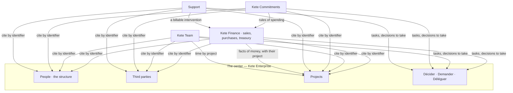

# References and four apps (2026-10-13)

The model decided on 2026-10-13 (doctrine D-047 to D-049, `docs/ROADMAP.md`): what the center
holds, what each app holds, and how they speak. The screens were drawn with the workspace design
and shown to the author; this document keeps their content in text.

## The whole in one picture



- **The center holds references**: who (people), with whom (third parties), on what (projects).
- **An app holds facts**, in its own database, and cites a reference by its identifier — never a
  copy.
- **These apps need the center.** They are not sold alone. When the center does not answer, an app
  goes on with what it knows (`@kete/center`).

## The project, one object

| What hangs on it       | What the project gives it                                             |
| ---------------------- | --------------------------------------------------------------------- |
| Money                  | Funds received, a budget by post, committed, spent, available, margin |
| People                 | A team, and a lead                                                    |
| Rights                 | A second axis: she sees what touches her units and her projects       |
| Decisions              | A circuit may pass by the project's lead                              |
| Threads, files, memory | Everything said and written on it, with its instructions              |
| Agents                 | An agent attached to it, limited to it                                |
| Contracts              | Its contract, its obligations, its deadlines                          |
| Tickets                | What breaks after delivery, charged to it                             |

Its life: born from a sentence or from a won quote, whose lines become the posts of its budget —
so the expected margin is known at signature; executed (purchases, time, milestones, invoices by
milestone); delivered; closed on a statement (real margin against expected); open to support
while its warranty runs. Without a project, a fact goes to « Fonctionnement ».

```text
+---------------------+----------------------------------------------------------+
| Espace              | Chantier Garage Bè              Exécution, phase 3 sur 5 |
|   Décider           | ........................................................ |
|   Demander          | Vendu 2 480 000   Reçu 992 000   Dépensé 896 000         |
|   Déléguer          | Engagé 700 000    Disponible 96 000   Marge prévue 23 %  |
| > Projets           |                                                          |
|   Tiers             | BUDGET PAR POSTE                                         |
|   Apps              |  Matériel      1 320 000 sur 1 450 000   reste 130 000   |
|                     |  Main-d'œuvre    180 000 sur   300 000   reste 120 000   |
|                     |  Déplacements     96 000 sur   150 000   reste  54 000   |
|                     |                                                          |
|                     | CE QUI ATTEND                                            |
|                     |  Câbles et protections · 190 000 · dépasse le poste      |
|                     |  Jalon « Livraison » atteint · à facturer 744 000        |
|                     |                                                          |
|                     | Agent du projet: les commandes dépassent les fonds reçus |
|                     | de 604 000 F. Facturer le jalon couvre l'écart.          |
+---------------------+----------------------------------------------------------+
```

## The third party, one record

The same company may be a client, a supplier and a funder. One record: its roles, how it likes to
be reached, how it pays, and what each app knows of it — a quote waiting in Kete Finance, a contract in
Kete Commitments, a ticket in Support. Duplicates are proposed, and merged by a person.

## Money (D-049)

- **Three states**: in the bank, the tills and mobile money; **reserved** for projects (a deposit
  received is not yet one's own); **committed** (an order placed, a pay due). « Really available »
  is what is left.
- **By project**: received, committed, spent, available; what it earns; whether its funds paid what
  they were received for.
- **A commitment counts when the order is placed**, not when its invoice arrives.
- **Separation of roles**: who asks does not approve; who approves does not pay.
- **Proof**: every gesture of money carries its piece; a draft read from a photo shows where each
  field comes from.
- **Kete executes no payment** and keeps no general ledger. Amounts are integers of the currency's
  smallest unit (`@kete/money`), computed by code.

## The four apps

Each has the same shape: a question on top, three figures, what needs a gesture, what its agent
prepared — which also arrives in « Décider ». Work enters without typing: a message, a voice note,
a photo, a document, on WhatsApp, Telegram or the center.

### Kete Finance — « Combien ai-je vraiment, projet par projet ? »

One app, one register of money, three parts.

| Part                   | Holds                                                                      | Its deep rules                                                                                           |
| ---------------------- | -------------------------------------------------------------------------- | -------------------------------------------------------------------------------------------------------- |
| Sales                  | Quotes, invoices, deposits, receipts of payment, a catalogue with prices   | A quote carries its cost; delivered and not invoiced is listed; a late payer owes a deposit              |
| Purchases and expenses | Requests, orders, receptions, suppliers' invoices, expense notes, advances | A request names its project and post; three pieces match; an advance is justified; prices are remembered |
| Treasury               | Accounts, movements, reconciliation, funds by project, tills               | Three states of money; a till closes each day; a project's funds are not another's                       |

Its agent prepares: a quote from the catalogue's prices (never an invented price), reminders of
unpaid invoices, the comparison of three offers, the reading of a statement, the report of the use
of a project's funds. Never alone: sending a quote or an invoice, granting a discount, committing
a spend, paying.

### Kete Team — « Qui est là, qui peut faire quoi, où passe le temps ? »

Holds: files of the staff, leave and absences with their balances, authorisations with their
expiry, time by project, advances on salary, the month's pay elements, arrivals and departures.

Its deep rules: time by project is asked once a week, in one answer — without it a project's
margin ignores its first cost; a person whose authorisation expired cannot be assigned where it is
required; an advance on salary is tracked and withheld; a departure hands on her agents and closes
her accesses. Each person sees her own file; a manager sees her team's absences, not their pay.

### Kete Commitments — « Qu'ai-je signé, qu'est-ce qui tombe, quel argent me revient ? »

Holds: contracts (clients, suppliers, leases, work, insurance), the obligations read in each — with
the passage cited — legal deadlines, retentions and bonds, proofs, models. It starts from the
center's compliance (controls, proofs, deadlines).

Its deep rules: a retention or a bond is money that comes back at a date, and is claimed; a
funder's agreement becomes rules of spending that Kete Finance applies, and a refusal names the
article; an obligation closes on its proof. Its agent never signs, never terminates; what it reads
is checked once by a person. It is not legal advice.

### Support — « Quel client attend, et qui paie l'intervention ? »

Exists (`kete-helpdesk`): queues, a criticality grid, a clock, indicators. Added: a ticket knows
what the client bought — under warranty, under contract, or billable; a billable intervention
prepares its invoice in Kete Finance; a ticket's cost goes to its project, so a project that breaks
ten times is no longer profitable; three tickets on one product are a signal for purchases.

## How they speak

| From             | To           | What passes                                           |
| ---------------- | ------------ | ----------------------------------------------------- |
| Every app        | The center   | Tasks and decisions for « Décider », by its circuits  |
| Kete Finance     | The center   | Facts of money, each with its project and third party |
| Kete Finance     | The center   | A won quote opens a project, its lines as posts       |
| Kete Team        | The center   | Time by project; an absence, and who takes over       |
| Kete Commitments | Kete Finance | A funder's rules of spending                          |
| Support          | Kete Finance | A billable intervention to invoice                    |
| Support          | Kete Finance | Three tickets on a supplier's product                 |

An app asks another through the center's gateway, with the person's mandate: it never reads
another app's database.

## What is not proven

The reading of a bank statement, of mobile-money messages, of receipts and of a contract by a real
model — on which treasury and commitments rest. Whether people keep the habits the model asks:
time by project each week, a till closed each day.
