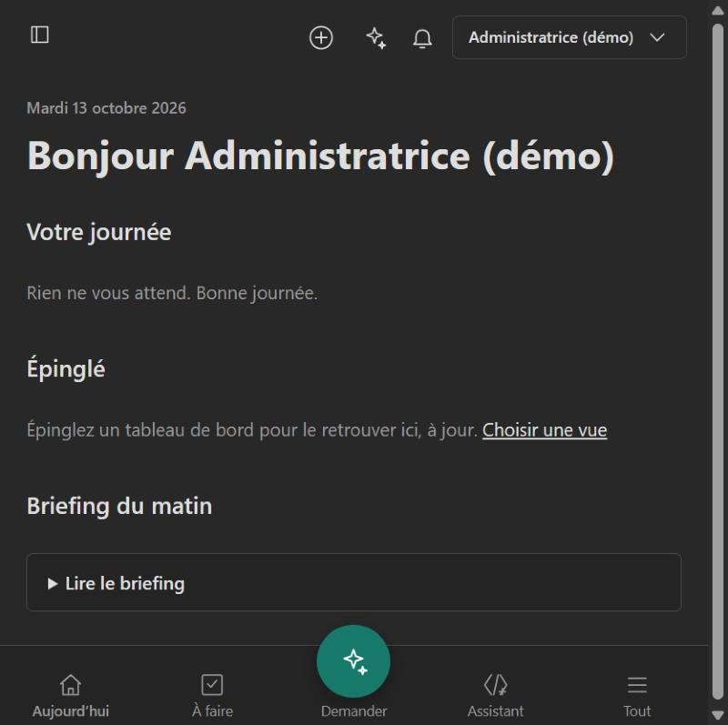
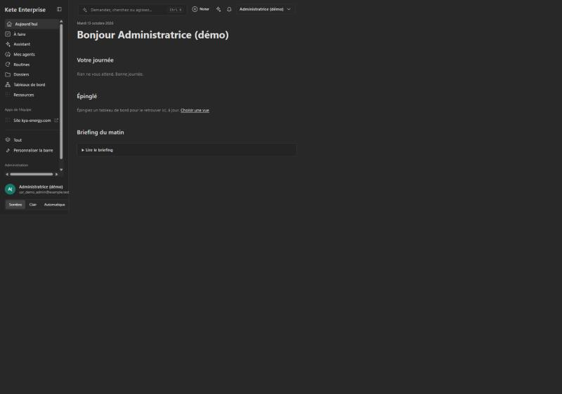
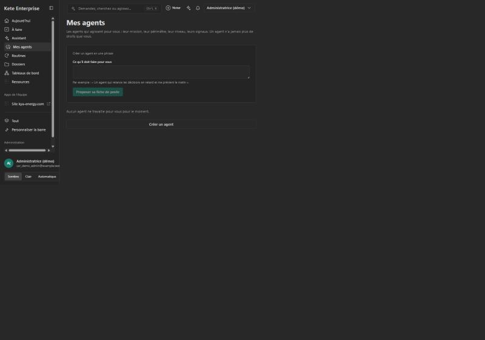
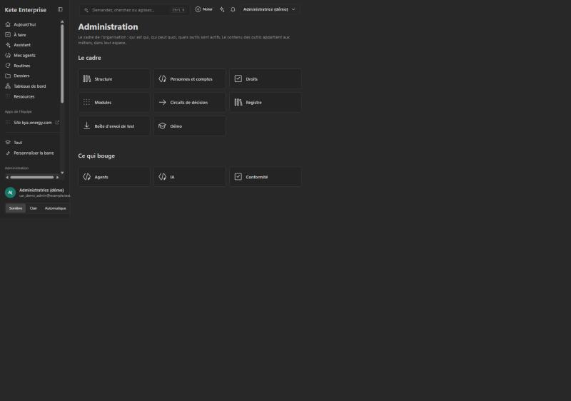
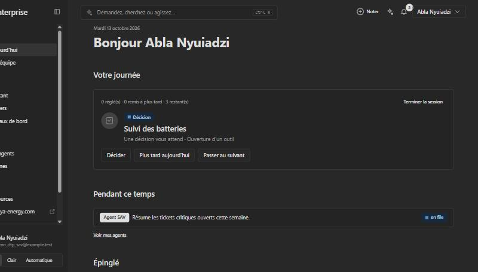

# The product as it is, and its gaps to the reference (2026-10-13)

Step **A2** of the plan (`docs/ROADMAP.md`). Kete Enterprise was run on this day with `pnpm demo` —
the KYA demo organization on a throwaway schema of the test database, no Compte Kete — and looked
at as the organization's administrator, on a desk and on a phone. This is what was seen, against
[`screens-2026.md`](screens-2026.md).

**How far this goes.** The demo's administrator has nothing to do: the seed creates the structure,
the roles, the questionnaires, the performance referential — and no decision, no task, no agent at
work. No model is configured, so the assistant answers « pas encore configuré ». Screens that only
show something with work in them (a decision with its analysis, « Pendant ce temps », a thread)
were **read in the code, not seen**. Each line below says which.

## What is already there — closer than the plan assumed

| Seen                                                                                                                                                                                                    | Where it stands against the reference                                                                         |
| ------------------------------------------------------------------------------------------------------------------------------------------------------------------------------------------------------- | ------------------------------------------------------------------------------------------------------------- |
| The top bar carries « Demandez, cherchez ou agissez… Ctrl K », « Noter », the assistant and the bell, on every page                                                                                     | Is the reference's « Demander » on top. Kept                                                                  |
| The sidebar shows **eight** places by default (Aujourd'hui, À faire, Assistant, Mes agents, Routines, Dossiers, Tableaux de bord, Ressources), the team's apps, « Tout » and « Personnaliser la barre » | Not the twenty places the plan said: the rest sits behind « Tout ». Still eight where the reference has three |
| On a phone: four tabs and a round « Demander » button in the middle                                                                                                                                     | The reference's phone, with other names                                                                       |
| « Aujourd'hui »: « Votre journée », « Épinglé », « Briefing du matin »                                                                                                                                  | The morning exists; it is a page of sections, not yet one decision at a time                                  |
| « Mes agents » opens on « Créer un agent en une phrase » and « Proposer sa fiche de poste »                                                                                                             | Step C7's creation from a sentence exists; its dry run does not                                               |
| « Administration »: eight tiles under « Le cadre », three under « Ce qui bouge »                                                                                                                        | Eleven where the reference has six                                                                            |

## The gaps, step by step

| Step | Gap                                                                                                                                                                                                                                      | Seen or read |
| ---- | ---------------------------------------------------------------------------------------------------------------------------------------------------------------------------------------------------------------------------------------- | ------------ |
| C1   | Eight places become three: « Aujourd'hui » and « À faire » → **Décider**; « Assistant » and « Dossiers » → **Demander**; « Mes agents » and « Routines » → **Déléguer**. « Tableaux de bord » become pieces, « Ressources » goes to Apps | Seen         |
| C1   | The projects and their threads are not in the sidebar; pinned things are shortcuts, not threads                                                                                                                                          | Seen         |
| C1   | On a wide screen the content keeps a narrow column and leaves most of the page empty                                                                                                                                                     | Seen         |
| C1   | The states offline, error and limit reached: an error shows « Something went wrong! », in English, with no way back                                                                                                                      | Seen         |
| C2   | « À faire » and « Aujourd'hui » are two pages; a decision opens beside its list (spec 047), not as the next card of a pile                                                                                                               | Read         |
| C2   | A decision cannot be taken by a reply on WhatsApp or Telegram                                                                                                                                                                            | Read         |
| C2   | **The demo has no day in it.** Nothing lets a person try « the morning of the after-sales manager »: it needs a seeded day — two decisions, three things to know, what agents did overnight                                              | Seen         |
| C3   | The assistant could not be seen answering: no model in the demo. In the code an answer is text with its tools' cards; no table to sort and act on                                                                                        | Read         |
| C4   | The canvas shows a document beside the thread; there is no list of a thread's files, no viewer that opens a source at its line, no review of changes                                                                                     | Read         |
| C5   | A thread belongs to one person; « Dossiers » are apart from the chat; a request to a colleague has no states                                                                                                                             | Read         |
| C6   | An agent has no private or shared visibility; no single vocabulary of states; no run seen live                                                                                                                                           | Read         |
| C7   | No dry run before an agent starts; no « Mon accueil »; the factory's coding agent is followed through its pull request only                                                                                                              | Read         |
| C8   | « Règles » do not exist: the only rule is who pays for AI. « Conformité » is a tool of the center, not the evidence of the registry and the journal                                                                                      | Seen         |
| C10  | « Enquêtes », « Performance », « Conformité » sit under « Outils » inside the center; « Réunions » did not show for this organization                                                                                                    | Seen         |

## Defects met while looking

| Defect                                                                                                                                                                        | Where                                                    | Treated in      |
| ----------------------------------------------------------------------------------------------------------------------------------------------------------------------------- | -------------------------------------------------------- | --------------- |
| A note with a reminder answers 500 on an instance served in http: the reminder's task carries an absolute address and the database only accepts `https://` (`app_tasks.href`) | `features/notes/notes.ts`, `features/workspace/tasks.ts` | C2              |
| A decision is shown with its technical subject — « Une décision vous attend · registry.promotion » — instead of words                                                         | « Aujourd'hui », « Votre journée »                       | C2              |
| « View as » a person without an account shows the page's error instead of saying she has no account                                                                           | The screens' session                                     | C1, second part |

The first two were fixed in spec 062. Décider as it is since:

## Corrections to the plan

- The plan spoke of « a sidebar of about twenty places ». The sidebar shows eight; twenty is what
  « Tout » lists. Step C1 is smaller than announced, and its real work is the merge into three.
- « View as » only works for a demo person **who has an account**; the demo script now lists those.
- A seeded day for the demo is added to step C2: without it nothing can be tried, by a person or
  by a test.

## Running it

`pnpm demo` (see `apps/api/scripts/demo.ts`): builds the screens, creates a schema in the test
database of `.env`, seeds the KYA profile, and serves the API (3600), the screens (3500) and a
local door (3501) that signs a browser in. `--fresh` reuses the last build. Stopping it drops the
schema; a run that was killed is cleaned up by the next one. Nothing of it is a deployment.
