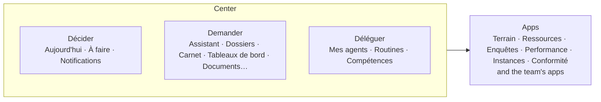

# Spec 061 — The frame: three places

Step **C1** of the plan (`docs/ROADMAP.md`, doctrine D-042). First part.

## Why

The center is three things a person does — **Décider**, **Demander**, **Déléguer** — and the apps
behind. The sidebar listed eight pages side by side, « Tout » sorted them into « Mon espace » and
« Outils », and the phone's tabs named pages. Nothing said what the product is for. And a page that
failed showed the framework's own « Something went wrong! », in English, with no way back
(`docs/design/gaps-2026-10.md`).

## What changes

- **One place per page** (`apps/web/src/lib/verbs.ts`): every page belongs to Décider, Demander,
  Déléguer or Apps. A business tool is an app: it is listed behind the center.
- **The sidebar** shows the three places with the pages she kept, her own shortcuts, then the apps
  (her team's apps with the tools). What she hid stays hidden; « Personnaliser la barre » is
  unchanged.
- **« Tout »** lists the same three places, then the apps, then the Administration.
- **The phone's tabs**: Décider, À faire, the round « Demander », Déléguer, Tout. « À faire » keeps
  its tab until it merges into Décider (step C2).
- **A page that fails** says so in her language — « Cette page n'a pas pu s'afficher. Rien n'a été
  modifié. » — with « Réessayer » and « Revenir à Décider » (`apps/web/src/lib/page-error.tsx`).

## What stays for the next steps

A place still lists its pages: they merge inside it step by step — « Aujourd'hui » and « À faire »
in C2, the assistant and the dossiers as projects in C5, agents and routines in C6 and C7. The
projects and their threads enter the sidebar with C5. The states « hors ligne » and « limite
atteinte » come with the offers (`kete-core` step B6). The wide-screen layout of each page is
treated with its page.

## Proof

- Seen with `pnpm demo` on 2026-10-13, as the demo's administrator: the sidebar and « Tout » group
  under Décider, Demander, Déléguer and Apps; the phone shows the five tabs; a view-as of a person
  who does not exist shows the page's error in French, with its two ways out.
- `pnpm check` passes (types, formatting, no hard-coded visible text).
- No automated test covers the screens (the author's choice of 2026-10-12): this is seen, not
  tested.
