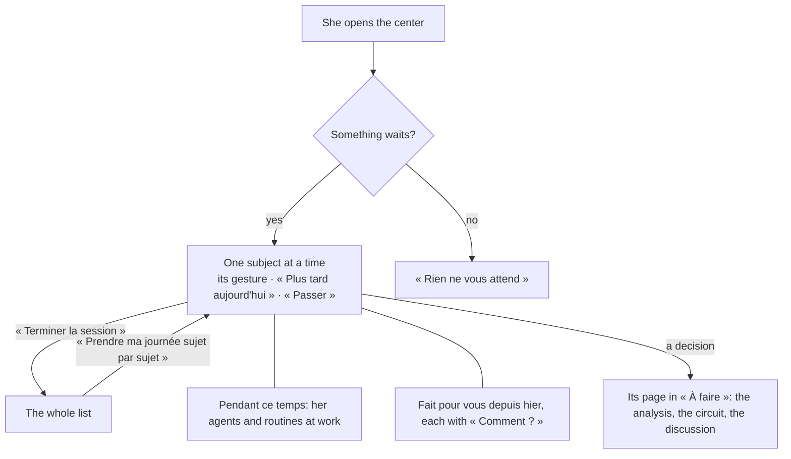

# Spec 062 — Décider

Step **C2** of the plan (`docs/ROADMAP.md`, doctrine D-042). « Aujourd'hui » and « À faire » become
one place: what waits for a person, one subject at a time.

## Why

The product opens on what waits for the person, not on a menu (doctrine D-045, rule 1). The pieces
were there — the day's subjects, the session « sujet par sujet » (spec 058), « Pendant ce temps »,
« Fait pour vous » — but spread over two pages, the session behind a button, and nothing to try
them with: the demo's administrator had nothing to decide.

## What changes

- **Décider opens on one subject at a time** when something waits. « Terminer la session » shows
  the whole list; the session's own button brings the pile back. A person viewed by an
  administrator keeps the list (her session is hers).
- **« À faire » is no longer a place of its own**: it left the sidebar and the phone's tabs. Its
  count sits on Décider; a decision still opens on its page, with its analysis, its circuit and its
  discussion (spec 047).
- **A place that holds one page takes its name**: the sidebar shows « Décider », not « Décider ›
  Aujourd'hui ».
- **A decision is said in words.** A feature's own subject carries its words like an app's:
  « Une décision vous attend · Ouverture d'un outil », never « registry.promotion ».
- **A reminder is filed on any instance.** A task that leads to a page of the space carries its
  public address when the instance has an https one, its path otherwise (migration
  `0049_task_paths`; a path starts with one slash only). A note's reminder no longer needs
  `PUBLIC_WEB_URL`, and no longer answers 500 on an instance served in http.
- **The demo has a day in it** (`apps/api/db/demo/day.ts`): two decisions wait for the head of
  after-sales, a reminder, her agent with one task done and one waiting — played through the API
  as the demo's own people, no model called. `pnpm demo` prints the address of her morning.

## What stays for later

- **The evidence inside the card.** A decision's analysis with its sources is on its page, not yet
  in the pile's card.
- **A decision taken by a reply on WhatsApp or Telegram.** It needs the outbox of `kete-core`
  (its step B2).
- **The two pages as one screen.** « À faire » keeps its own page for a decision's detail.

## Proof

- `apps/api/tests/notes.test.ts`: a reminder filed on an instance without an https address leads
  to `/carnet`. The 24 tests of notes, exchanges, decisions and « À faire » pass.
- Seen with `pnpm demo` on 2026-10-13, signed in as Abla Nyuiadzi: « Votre journée » shows one
  subject — « Suivi des batteries · Une décision vous attend · Ouverture d'un outil » — with
  « 0 réglé(s) · 0 remis à plus tard · 3 restant(s) »; « Pendant ce temps » shows her agent's
  waiting task; « Fait pour vous depuis hier » the reminder it prepared, with « Comment ? ».
- The screens have no automated test (the author's choice of 2026-10-12): the page is seen, not
  tested.
