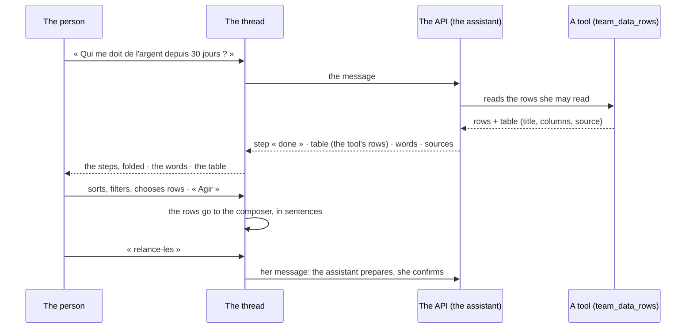

# Spec 063 — Demander: an answer that is a tool

Step **C3** of the plan (`docs/ROADMAP.md`, doctrine D-042 and D-045). An answer is not only
words: when a tool read rows, the answer is a table a person sorts, filters and acts on.

## Why

In the chat, an answer was text with one card per tool. A question such as « qui me doit de
l'argent ? » came back as a paragraph the model wrote from the rows it read: figures copied by a
model, nothing to sort, nothing to act on. The reference screen
(`docs/design/screens-2026.md`, « An answer ») asks for the opposite: the figures are the code's,
the steps unfold, and what the answer produced sits under its words.

## What changes

- **A tool says how to show what it read.** A tool's result may carry `table` — a title, columns,
  a source — beside its `rows`. The chat keeps the columns the table names, 200 rows at most, and
  streams it as a `table` event; it is kept with the answer (migration `0050_assistant_tables`).
  The rows are never the model's. An app's tool (MCP) does the same with no view of its own.
- **The team's data answer in tables.** `team_data_rows` gives the rows themselves — filtered,
  sorted, the useful columns; `team_data_query` gives its summed-up rows with each measure named
  (`{ fn: 'sum', column: 'Dû' }`), which the screens say in words (« Somme de Dû »).
- **The table in the thread.** Sorting by a column, a filter over every column, rows chosen one by
  one or all at once (TanStack Table), dressed with `@kete/design`'s `DataTable`. « Copier » gives
  the rows as a sheet takes them. The source opens the whole data set.
- **Acting on rows.** « Agir » on a row, or on the selection, writes the rows in the composer as
  sentences; she adds what she wants done. Nothing is done from the table: the assistant prepares,
  and she confirms a draft as for any gesture.
- **Steps that unfold.** The tools of an answer are its steps, folded once it has its words
  (« 2 étape(s) »), open while it works. What the answer produced — tables, the canvas, drafts,
  an app's view — sits under its words, never folded with the steps.
- **A message in line.** While an answer is being written, what she sends waits « en file » and
  leaves as soon as the answer ends; it can be taken back before. The queue is assistant-ui's own
  (`createMessageQueue`), set so that a message never interrupts an answer: « Arrêter » is the only
  gesture that stops one.
- **The demo answers.** `pnpm demo` has no model: its assistant's answers are written in advance
  (`apps/api/db/demo/answers.ts`) and read the demo's « Factures impayées » with the real tool.

## What stays for later

- **Modes** (rapide, réfléchi, recherche longue) and the choice of tools in the composer: long
  research comes with step C5.
- **Gestures named by the tool** on a row (« Relancer », « Appeler »): the contract leaves room
  for them; no tool gives any yet.
- **« Garder sur Aujourd'hui », « Chaque lundi »** under a table: they exist as a dashboard's pin
  and as a scheduled question, not yet as buttons under an answer.
- **The duration of an answer** beside its steps.

## Proof

- `apps/api/tests/answer-tables.test.ts` (5 cases): the rows tool gives her filtered, sorted rows
  with the data set's own columns, says an unknown column, and finds nothing she may not read; a
  measure is named, not worded; a table keeps only the columns it names, is nothing without rows
  or with a source outside the space, and stops at 200 rows; the chat streams the table its tool
  read and keeps it with the answer; no table for what she may not read.
- Seen with `pnpm demo` on 2026-10-13, signed in as Abla Nyuiadzi: « Qui me doit de l'argent
  depuis 30 jours ? » returns « 1 étape(s) », the words, then the table of three invoices read by
  the tool; a click on « Jours » sorts it both ways; « kossi » in the filter leaves one row of
  three; two rows chosen and « Agir sur la sélection (2) » write both rows in the composer, in
  sentences; a second message sent while the answer was being written showed « En file », then
  left and was answered in turn.
- The screens have no automated test (the author's choice of 2026-10-12).
