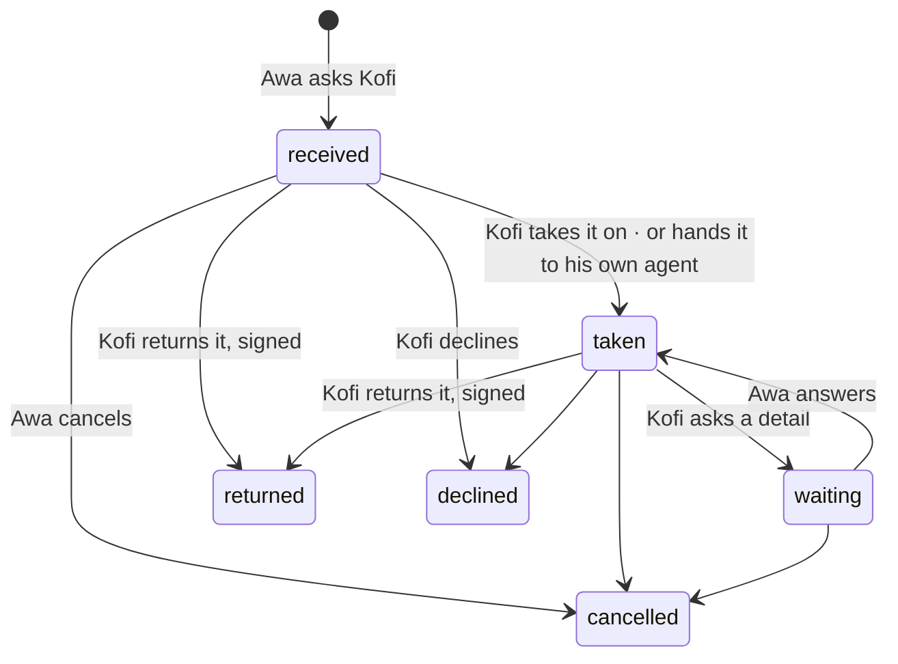

# Spec 065 — Asking a colleague

Step **C5** of the plan (`docs/ROADMAP.md`, doctrine D-044), first part: a request to a colleague
with its states, worked by her and her agent in one thread, and returned signed.

## Why

« Entre assistants » (spec 057) lets an assistant ask a colleague's for a fact. Work is something
else: « chiffre le devis Garage Bè », for Thursday. D-044 settles it: work is asked of a **person**,
never of her private agents; who asks sees a state, not how the other organises herself; what comes
back is hers — signed by her, saying whether her agent prepared it.

## What changes

- **A request goes to a person** (`/v1/requests`, `/demandes`): a colleague the directory shows her,
  a title, details, a date. It arrives in the colleague's « À faire », and she is told.
- **Its states**: reçue, prise en charge, « vous attend » (a detail asked back — it then sits in the
  asker's « À faire »), rendue; or refusée, annulée. Each move is the gesture of one of the two;
  the other is told. A reminder, once a day at most.
- **Her own agent, never another's**: she may hand the work to one of her agents. It works with her
  rights; when it is done, she reads what it prepared in the thread and may take it.
- **One thread**: what the two people write and do, and the agent's work — shown to her in full;
  to who asked, only that an agent worked.
- **Returned signed**: what goes back is signed by the person asked, and says « préparé par Agent
  Devis, relu et signé par Kofi » when her agent prepared it.
- **The demo**: Délali asks Abla for a quote; Abla handed it to her Agent SAV, whose work waits for
  her signature.

## What stays for later

Projects (threads, files, instructions, memory of a project), threads shared with several people,
long research in the background, voice; « Mon accueil » with its rules (step C7); an interim who
takes over an absent person's requests; a request answered by WhatsApp or Telegram.

## Proof

- `apps/api/tests/requests.test.ts` (8): a request goes to a person and into her « À faire »;
  nobody else reads or moves it; she hands it to her own agent and to no one else's; the agent's
  work is hers to read, who asked only sees that an agent worked; asking back and answering move the
  state both ways; **it comes back signed by her, saying her agent prepared it**, and **two people and
  an agent work in one thread**; a reminder once a day; cancelled by who asked; not to oneself nor to
  someone unknown.
- Seen with `pnpm demo` on 2026-10-13, as Abla Nyuiadzi: « Demandes » shows « Chiffre le devis
  Garage Bè », asked by Folly Ayité, « Prise en charge »; its thread shows his request, her hand-over,
  and her Agent SAV's quote; « Reprendre ce que Agent SAV a préparé » then « Rendre, signé par moi »
  returns it: « Préparé par Agent SAV, relu et signé par Abla Nyuiadzi ».
