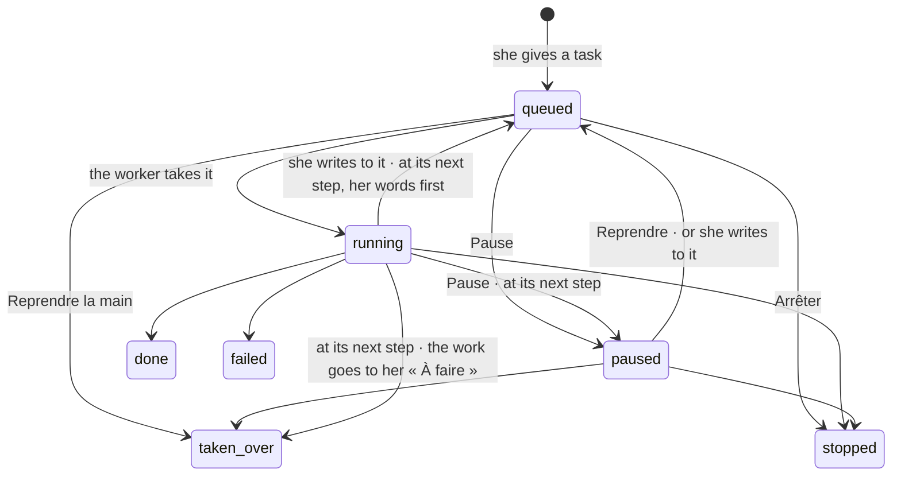

# Spec 066 — Agents at work

Step **C6** of the plan (`docs/ROADMAP.md`, doctrine D-044 and D-045), first part: an agent is
steered while it works, it is in one of six states on every screen, it is private or shared, and
its tasks run on the agents' runtime (`@kete/agents`, `kete-core` decision 0010).

## Why

A task given to an agent (spec 036) ran to its end or was stopped: nothing in between. A person who
sees her agent going the wrong way wants to stop it for a moment, tell it something, or do the
work herself with what it already did. D-045 asks that an agent's state be shown the same way
everywhere; D-044 that an agent be private, or shared with colleagues who then call it with their
own rights.

## What changes

- **Steered while it works** (`/v1/agents/tasks/:taskId/pause|resume|write|take-over`): the person
  who gave the task, or the agent's person, pauses it, writes to it, takes the work over. A task
  not yet started obeys at once. A running one reads what she asked **before each of its steps**
  and stops there: paused; queued again with her words, which come before its instruction; or
  handed back to her, in her « À faire ». What it did is kept, and it is told so when it goes on.
- **Steps written as they happen**: each tool it calls is added to the task at once — the run is
  seen while it runs, and an interrupted task keeps its steps and its drafts.
- **Six states** (`state` on `GET /v1/agents`, `stateOfAgent`): en veille (its next round),
  travaille (the task, its steps), vous attend (its drafts that wait for her), bloqué (what its
  last task lacked), en pause (who paused it, since when), arrêté (the organization's kill
  switch). « Mes agents » shows the state on each card; « Pendant ce temps » shows paused tasks.
- **Private or shared** (`POST /v1/agents/:agentId/sharing`, journaled as `share-agent`): an agent
  is private by default. Its person — she alone — opens it to everyone, or to units and those
  under them. A colleague it is open to sees its name and mission, gives it a task and follows what
  she asked (`GET /v1/agents/tasks/given`). **It then acts with her rights, narrowed to what the
  agent may do — never with its owner's.** Its owner sees what it did for others.
- **On the runtime**: `runTask` calls `runAgent` (`@kete/agents`); the capabilities stay its only
  tools, so its rights, its drafts and the journal are unchanged. Routines and watches call no
  model: they are computed by code, and have nothing to move.
- **The demo**: Abla's Agent SAV has a task waiting, to pause, write to and take over; her director
  shares an « Agent Achats » with everyone.

## What stays for later

The plan of a run and its budget shown beside its steps; a shared agent mentioned in a thread
(`@Agent Achats`) and hand-overs between agents drawn in the thread; the journal naming the
agent's owner beside who called it (today: the agent, for who called it); the interim taking over
an absent person's agents; steering a routine's run.

## Proof

- `apps/api/tests/agents-at-work.test.ts` (10): **an agent is paused, redirected and taken over** —
  paused before it starts and resumed; paused at work, it stops at its next step and keeps what it
  did, then goes on told what it did; her words come before its instruction; taken over, the work
  is in her « À faire » and nothing steers it any more; only its person steers it; blocked and
  stopped are said. An agent is private until its person opens it, to the units she chooses; a
  colleague's task runs for the colleague and is hers to follow; closed again by its person.
- `apps/api/tests/agent-tasks.test.ts` (13), `requests.test.ts` (8), `today-session.test.ts` (4):
  unchanged on the runtime, plus « vous attend » when a draft waits.
- Seen with `pnpm demo` on 2026-10-13, as Abla Nyuiadzi: « Mes agents » shows Agent SAV « Travaille »;
  « Pause » turns its task and the agent « En pause — Mis en pause par Abla Nyuiadzi »; « Reprendre la
  main » marks it « Reprise en main » and « À faire » shows « Repris à Agent SAV : Résume les tickets
  critiques ouverts cette semaine. »; « Agents partagés avec vous » lists Agent Achats.
- Not proven: a real model interrupted mid-run (the tests script the model); a shared agent reading
  data with the caller's narrower rights (the caller is the acting person by construction — no
  test compares two people's rights on one shared agent yet).
