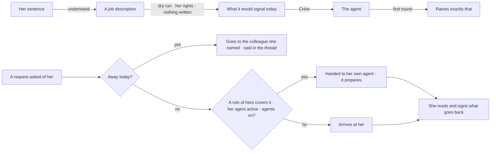

# Spec 067 — My desk

Step **C7** of the plan (`docs/ROADMAP.md`, doctrine D-044), first part: an agent born of a
sentence is tried before it exists, and « Mon accueil » says what arrives at a person and who takes
care of it.

## Why

An agent could be created from a sentence (spec 052), and started at once on what its person had
never seen it do. And a request to a colleague (spec 065) always arrived at her, even when she
hands every quote to the same agent, even when she is on leave. D-044 asks for « Mon accueil »: it
works with nothing set, a rule is hers, and its safeguards hold whatever she sets.

## What changes

- **The dry run** (`POST /v1/agents/dry-run`): what a job description — its watches, its
  permissions, its scope — would signal **today**, read with her rights. It runs the same reading
  as a round (`findingsOf`), so the agent's first round raises exactly what the dry run said.
  Nothing is created, nothing is written. « Créer » waits for it, then creates the agent and runs
  its first round at once.
- **« Mon accueil »** (`/v1/reception`, `/mon-accueil`), hers alone:
  - With nothing set, everything arrives at her.
  - **A rule**: requests whose title or details speak of one of her words go to one of **her own**
    agents, which prepares. Words are compared without case nor accents; her first rule that
    applies wins.
  - **Away**: between two days, what is asked of her goes to a colleague the directory shows her;
    the thread says so. One hop only, and never back to who asks.
  - **« Essayer sur une demande »**: what would become of it today. Nothing is written.
- **Its safeguards**:
  - A rule names only her own, active agent — never a colleague's, even one shared with her.
  - The organization's kill switch comes before her rules: agents off, everything arrives at her.
  - Nothing a rule does goes back to who asked without her signature: the agent prepares, and the
    return is hers, saying her agent prepared it (spec 065).
  - Who asks sees a state — never her rules, nor what her agent prepared.
- **The demo**: any sentence proposes « Veille de mes décisions » with its dry run; Abla's front
  desk hands what speaks of « devis » to her Agent SAV.

## What stays for later

A dry run **on last week**: the watches read today's state, not the past — each would have to read
as of a date. An agent that answers alone what the asker may already read; rules proposed from
what she does, and written from a sentence; a rule by who asks (« tout ce qui vient de la
Direction »); an acknowledgement outside her hours; routines listed with their agent; the
factory's agent seen at work (file, terminal, preview, tests) — it is still followed through its
pull request.

## Proof

- `apps/api/tests/my-desk.test.ts` (9): **an agent created from a sentence runs after its dry
  run** — the dry run names the app without an identity card, nothing exists yet, and the created
  agent's first round raises the same; a watch without its permission says nothing; a colleague's
  space is not hers to try on. « Mon accueil »: everything arrives at her by default; a rule never
  names a colleague's agent, shared or not; a covered request is handed to her agent, who asked
  sees only a state, and she signs the return; the trial writes nothing; the kill switch and a
  paused agent put the rule aside; away, her requests go to the colleague she named, never back to
  who asks, and only between the two days.
- Seen with `pnpm demo` on 2026-10-13, as Abla Nyuiadzi: « Mon accueil » shows « devis, chiffrage —
  Agent SAV prépare — Je relis et je signe » and « Le reste — Moi »; trying « Un chiffrage pour l’hôtel
  du Golfe » answers « Agent SAV prépare la réponse, par votre règle « chiffrage ». Ce qui repart est
  relu et signé par une personne. »; in « Mes agents », a sentence proposes « Veille de mes décisions »
  with « Essai à blanc — Aujourd’hui, il n’aurait rien eu à vous signaler. », and « Créer cet agent »
  answers « Agent créé. Sa première ronde a signalé 0 chose(s). ».
- Not proven: a real model understanding a sentence (the tests and the demo script it).
