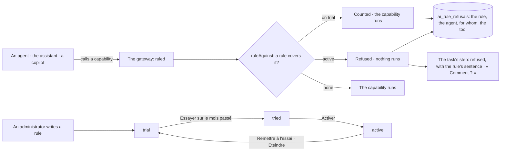

# Spec 068 — Rules

Step **C8** of the plan (`docs/ROADMAP.md`, doctrine D-043), first part: the organization's rules
for its agents — a sentence, applied at one point of passage, tried on the last month before it is
switched on, and every refusal journaled with the rule that refused.

## Why

What an agent may do came from its person's rights and its own job description. An organization
had no way to say « no agent touches the invoices », or « no agent acts alone », once, for every
agent — its own, the assistant, a copilot through the gateway — and to see that it held. D-043
puts the rules at the heart of the trust layer.

## What changes

- **A rule** (`/v1/rules`, « Administration › Règles », administrators only): a family, a sentence,
  what it covers (permissions of the catalog). Written and switched through journaled commands
  (`create-ai-rule`, `set-ai-rule-state`).
- **Two families are applied today**, of the eight of D-043:
  - *Outils et connecteurs*: no agent uses what the rule covers — reading, preparing or acting.
  - *Autonomie*: no agent acts alone on what the rule covers (level 2); it still reads and
    prepares drafts a person decides. Nothing ticked: everywhere.
- **Born on trial**: a rule on trial refuses nothing; it counts what it would have refused.
- **Tried on the last month before it is switched on**: over the steps agents really took these
  thirty days — each recorded with its permission and its level (spec 056) — how many it would
  have refused, with examples. Counted by code. A rule that was never tried cannot be activated.
- **One point of passage** (`ruled`, in the gateway): the tools of an agent's task, of the
  assistant, and the calls of a copilot through the MCP gateway all ask the rules first. An active
  rule refuses; nothing runs.
- **The journal names it** (`ai_rule_refusals`, written once): the rule and its sentence, the
  agent, for whom, the channel, the tool, the permission. The refused step of a task carries the
  rule's sentence, and « Comment ? » shows it.
- **Never a person's own gesture**: a rule is for agents; what a person does or decides herself is
  ruled by her rights.

## What stays for later

The six other families (data, models, retention, transparency, budgets, exit): what they say is
settled elsewhere today (who pays for AI, the model's host, the conversations' keeping) and is not
yet written as a rule. A rule narrowed to a unit. The assistant's own tools that are not
capabilities of the gateway (datasets, library, documents). The registry's review dates,
duplicates, and a leaver's agents handed on; the Administration in six entries; an organization
imported from a spreadsheet or described in sentences.

## Proof

- `apps/api/tests/rules.test.ts` (8): only an administrator writes a rule, in an applied family,
  covering permissions that exist; on trial it refuses nothing and counts; it is switched on only
  once tried on the last month, which names the step it would have refused; **active, it refuses
  the agent's gesture — the step is refused with the rule's sentence, nothing is prepared, and the
  journal names the rule, the agent, for whom, the tool and the permission**; her copilot through
  the MCP gateway is refused the same way; her own decision of a draft is not; switched off, the
  agent works again; a rule on autonomy covers acting alone only.
- Seen with `pnpm demo` on 2026-10-13, as the administrator: « Administration › Règles » shows « Aucun
  agent n’agit seul : il lit et prépare, une personne décide. », « À l’essai », with « Essayez-la sur le
  mois passé avant de l’activer. »; « Essayer sur le mois passé » answers « Sur les 30 derniers jours,
  elle aurait refusé 0 étape(s) sur les 0 faites par les agents. » (the demo's agents called no
  capability); « Activer » then shows it active.
- Not proven: a rule tried on a month of real work — the demo and the tests hold a few steps.
