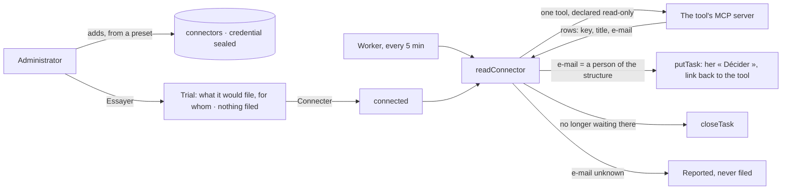

# Spec 069 — Connectors

Step **C9** of the plan (`docs/ROADMAP.md`), first part: a business tool the organization already
has — its ERP — is read through its MCP server, and what waits there for a person lands in her
« Décider ».

## Why

The center received what Kete apps send it (spec 018, spec 024): they carry the person's mandate.
An organization's own ERP knows nothing of Kete. Its purchase requests wait in a screen nobody
opens, while « Décider » is where a person looks. A connector reads them there — and only reads.

## What changes

- **A connector** (`/v1/connectors`, « Administration › Connecteurs », administrators only): the
  address of the tool's MCP server (https), its credential, and its **reading** — the server's tool
  that lists what waits, its arguments, which fields of a row say its identifier, its title and
  the e-mail of the person it waits for, and where she opens it. Added and switched through
  journaled commands (`create-connector`, `set-connector-status`).
- **Tried before it is connected**: « Essayer » calls the tool and says what it would file, for
  whom, and what waits for nobody the structure knows. Nothing is filed. A connector never tried
  with success cannot be connected.
- **Read every five minutes** (the worker), or at once (« Lire maintenant »): each row lands in the
  « Décider » of the person whose e-mail it names, as a task that opens the tool's own page. Read
  again, nothing doubles; what no longer waits in the tool leaves her « Décider ».
- **It reads, and nothing else**:
  - It calls the one tool it was given. A tool its server declares as writing (`readOnlyHint:
    false`, `destructiveHint`) is refused before any call.
  - Its tools are given to no agent and to no assistant.
  - Its credential is sealed (AES-256-GCM, `KETE_SECRETS_KEY`), kept out of the journal, and never
    returned by any route.
- **Frappe (ERPNext) first**, as a preset: the purchase requests waiting for approval
  (`Material Request`). A preset is a filled form — the connector knows no vendor. Frappe's
  community MCP servers do not name their tools alike, so the tool's name and arguments are the
  administrator's to adjust.
- **The demo**: an ERP written in advance, its connector on trial.

## What stays for later

E-mail and calendar connectors. Acting in the tool from the center (approving the request without
leaving « Décider »): a connector only reads. The list of apps with what the center receives from
each; « ask for an app » (spec 038) unchanged. A connector narrowed to units. An MCP server
reached over stdio: a connector needs an https address.

## Proof

- `apps/api/tests/connectors.test.ts` (6), against an ERP's MCP server served in memory: only an
  administrator adds a connector, and neither the list, the table nor the journal holds its
  credential in clear; the trial names the two requests it would file for Awa and the one waiting
  for nobody known, and files nothing; **connected, the worker's round files the purchase requests
  in her « Décider »**, each with its way back to the tool — hers only, and never twice; decided
  in the tool, a request leaves her « Décider »; a tool its server says writes is never called;
  switched off, it is no longer read.
- Seen with `pnpm demo` on 2026-10-13: as the administrator, « Administration › Connecteurs » shows « ERP
  de démonstration », « À l’essai »; « Essayer » answers « 3 en attente dans l’outil : 2 pour une personne
  connue, 1 sans personne connue »; « Connecter », then « Lire maintenant ». As Abla Nyuiadzi, « À faire »
  shows « Demande d’achat MAT-MR-2026-00041 : Huit batteries 200 Ah — site de Bè » and « Demande d’achat
  MAT-MR-2026-00042 : Câbles solaires 6 mm², 300 m ». The demo’s ERP is written in advance.
- **Not proven: a real Frappe.** No Frappe site nor any of its MCP servers was reached; the
  preset's tool name (`list_documents`) and arguments follow one family of community servers and
  must be checked against the server installed.
