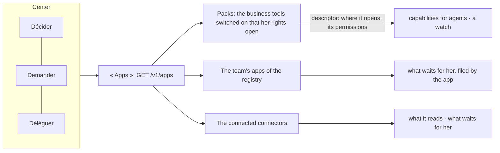

# Spec 070 — A lighter center

Step **C10** of the plan (`docs/ROADMAP.md`, doctrine D-042), first part: the center shows its
three places and one door, « Apps », to everything that stands behind it — with what the center
receives from each. The business tools are known through a descriptor; **they do not run apart
yet**.

## Why

D-042: the center has three places — Décider, Demander, Déléguer — and a business tool is an app.
Enquêtes, Performance, Réunions and Conformité were pages of the center, listed among its places.
And nothing said, for a tool behind the center, what the center gets from it.

## What changes

- **« Apps »** (`GET /v1/apps`, `/apps`): for the person, what stands behind the center.
  - *Vos outils existants*: the connected connectors (spec 069) — what each reads, and how many
    wait for her. Never its address nor its credential.
  - *Apps de l'équipe*: the active apps of the registry she may see, and how many tasks each filed
    for her.
  - *Outils métier*: the packs — Enquêtes, Performance, Réunions, Conformité — switched on and
    opened by her rights, with the capabilities agents may call there (counted from the gateway's
    own list) and whether an agent may watch it.
- **A pack is known by its descriptor** (`packs`): where it opens and the prefix of its
  permissions. What the center receives is computed from the gateway and the watches, not written
  by hand.
- **The center's menu**: the sidebar proposes « Apps » in place of « Ressources »; « Tout » lists
  the three places, then « Apps » as the one door to the tools. The catalogue of resources and
  « Demander une app » are reached from « Apps ».

## What is not done

**The four tools still run inside the center** — its process, its database, its pages. Making each
an app on the app contract (its own deployment built from the template, its `kete.json`, its MCP
server, its tasks and events sent to the center, its data moved) is the larger part of this step
and is not started. Until then the roadmap's proof, « the center has its three places and nothing
else », holds for what a person sees — the menu — not for what is deployed.

Also later: « Terrain » as an app; a pack's own tasks counted in what waits for her.

## Proof

- `apps/api/tests/apps-behind.test.ts` (4): no pack while none is switched on; switched on, each is
  listed with where it opens, the capabilities agents may call there and whether it may be
  watched; a person sees only the packs her rights open; switched off, a pack is gone.
- `apps/api/tests/connectors.test.ts`: « Apps » shows the connected connector with what it reads
  and the two requests waiting for her, none for a colleague, and never its address.
- Seen with `pnpm demo` on 2026-10-13, as the administrator: « Tout » lists Décider, Demander, Déléguer,
  then « Apps » alone; « Apps » shows the seven team apps, « Aucun outil connecté », and the four
  business tools — Performance « outils pour vos agents : 2 », Instances « outils pour vos agents : 1 »,
  Conformité « un agent peut le surveiller ».
