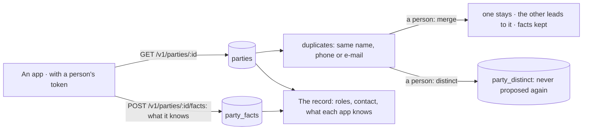

# Spec 073 — Third parties

Step **F1** of the plan (`docs/ROADMAP.md`, doctrine D-047): the center holds one record for each
company or person the organization works with, cited by every app.

## Why

Each app would keep its own clients and suppliers: the same hotel written three times, with three
phone numbers, and nobody able to say « what do we know of this client ». D-047 makes the third
party a reference of the center, like a person of the structure: apps hold facts and cite it.

## What changes

- **One record** (`/v1/parties`, `/tiers`): a company or a person, its roles — client, supplier,
  funder, partner, several at once — its contact, how it likes to be reached.
- **Read and managed by right**: `parties:read` reads, `parties:manage` writes and merges. An app
  reads with a person's token, within her rights.
- **Found** by its name without case, accent nor legal form, by its phone, by its role. The
  assistant and the agents find one through `parties_find`, under the same right.
- **What each app knows of it**: an app says a fact — a quote waiting, a contract, a ticket — by
  its own source and key; said again, it is replaced. The record shows them by app.
- **Duplicates** are proposed to who manages third parties: the same name once the legal form is
  gone, the same phone whatever its prefix, the same e-mail. A person merges them — one record
  stays, with the roles of both and what the other alone knew — or says they are distinct.
- **Every app follows**: a merged identifier answers with the record that stays, and an app may go
  on saying what it knows under it.
- **The demo**: six third parties, one written twice.

## What stays for later

Contacts of a company (several people); a third party's payment behaviour and balance, which
Gestion will say as facts; an address book imported from a spreadsheet; a third party seen by
units; un-merging.

## Proof

- `apps/api/tests/parties.test.ts` (7): written by who manages, read by who reads, unseen by who
  does neither and by another organization; found by name, phone and role; what each app says is
  kept once; a duplicate is proposed by its phone or its name; **two records of one company are
  merged, and every app follows** — the old identifier answers with the record that stays and its
  facts from both apps; two records said distinct are not proposed again; a record is corrected.
- Seen with `pnpm demo` on 2026-10-13: see the pull request.
