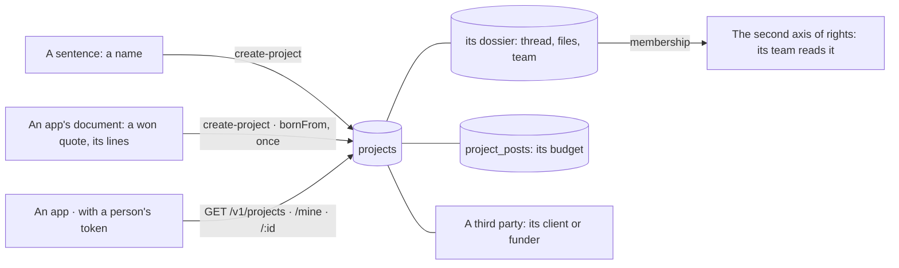

# Spec 074 — Projects

Step **F2** of the plan (`docs/ROADMAP.md`, doctrine D-047): a project is one object, held by the
center and cited by every app.

## Why

A job had its conversation in a dossier, its quote in one tool, its purchases in another, and no
place said « where does this job stand ». D-047 makes the project one object — where it is
discussed is where its team, its client and its budget are seen — and a reference every app
cites, so that every fact of money can carry it (D-049).

## What changes

- **One object** (`/v1/projects`, `/projets`): a name, a client or funder among the third
  parties, a lead, a phase, dates, what it was sold for, and a budget by post. Its **dossier** is
  born with it: its thread, its files, its team.
- **Born from a sentence**: a name is enough; who creates it leads it. **Born from an app's
  document**: its lines come as posts — two lines on one post add up — and asking again with the
  same document answers with the same project.
- **What it should earn**: sold less budget, computed, in the currency's smallest unit.
- **A second axis of rights**: whoever is in its team reads the project, its thread and its files,
  with no other right. Outside its team, a project does not exist — unless she reads them all
  (`projects:read`). Its lead, or who manages projects (`projects:manage`), changes it.
- **Read by the apps** with a person's token: the projects she belongs to, their identifiers
  (`/mine`), one project. The assistant and the agents read hers through `projects_mine`.
- **Closed, it is read**; it changes again once reopened.
- **The demo**: « Chantier Garage Bè », its client, its budget in three posts, led by Abla.

## What stays for later

Its money as it happens — received, committed, spent, available — which Gestion sends (step F4);
phases with their gates, and a circuit that passes by its lead (F3); an agent attached to it;
its contract and its tickets shown on its page; a project filtered in Décider, Demander and
Déléguer; amounts typed in a currency with decimals (the screens read whole units).

## Proof

- `apps/api/tests/projects.test.ts` (7): **a project born from a sentence shows its team, its
  budget, its thread** — a name creates it with its lead and its dossier; its posts add up and
  give its expected margin; a colleague added to its team reads it and its thread with no right on
  projects, and nobody outside does, nor another organization; born from an app's document once,
  its lines as posts; changed by its lead; it names a third party of the center; closed, it is
  read and refuses changes until reopened.
- Seen with `pnpm demo` on 2026-10-13: see the pull request.
