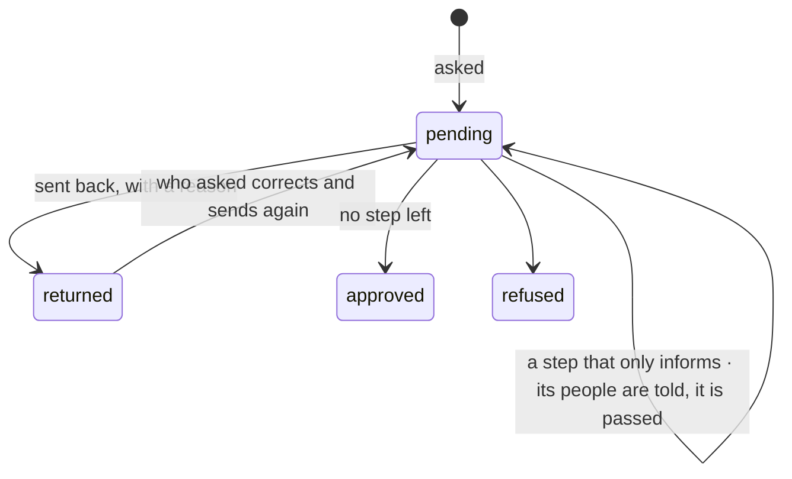

# Spec 075 — Circuits, completed

Step **F3** of the plan (`docs/ROADMAP.md`), first part: a circuit sends a request back to who
asked, tells people who only need to know, and passes by the lead of the request's project.

## Why

A circuit approved or refused: nothing in between. An expense note with a wrong amount was
refused, and written again from nothing. The accounts had to approve to be told. And a purchase on
a project went to the requester's manager, never to who leads the project (doctrine D-047).

## What changes

- **Sent back for correction** (`decision: return`, with a reason): the request waits for who
  asked; nobody decides it meanwhile; she is told what to correct. She **sends it again**
  (`POST /v1/decisions/requests/:id/resubmit`, or the app asking again with the same reference):
  it is the same request.
  - With the same amount or a lower one, it goes on where it was sent back: what was approved
    stays approved.
  - With a higher one, it starts again: nobody approved that amount.
  - Steps apply, or are skipped, by the new amount.
- **A step that only informs** (`inform: true`): its people are told when the request reaches it,
  and decide nothing; the request goes on at once.
- **A step by the project's lead** (`rule: project_lead`): a request carries its project; its
  lead decides. Without a project it finds nobody and goes to the administrators, like any step
  that finds nobody.
- **An app** asks with `projectId`, reads `returned` with its reason, and is told at its callback
  when its request comes back.
- **On the screens**: « Renvoyer pour correction » beside « Approuver » and « Refuser », on
  « À faire » and in the Inbox; her returned request shows its reason and « Renvoyer la demande »;
  a circuit's step may be « Le responsable du projet » and may only inform.

## What stays for later

Steps decided in parallel by several people; a request that goes up by itself after a delay; a
person informed at the end rather than at her place in the circuit; correcting more than a
request's title and amount from the center — an app corrects its own document.

## Proof

- `apps/api/tests/circuits-completed.test.ts` (6): a purchase passes by its requester's manager,
  then by **the lead of its project**, skips the direction under its threshold, and **tells the
  accounts, who decide nothing**; **a request sent back is corrected and decided, without a new
  one** — the reason is required, who asked and the app are told, nobody decides it meanwhile, and
  asked again through the app it is the same request; with the same amount it goes on where it was
  sent back; with a higher one it starts again and reaches the direction; without a project the
  lead's step goes to the administrators.
- The 18 test files touching decisions pass unchanged on the engine (127 tests).
- Not seen in the demo: its decisions come from a circuit with one step.
