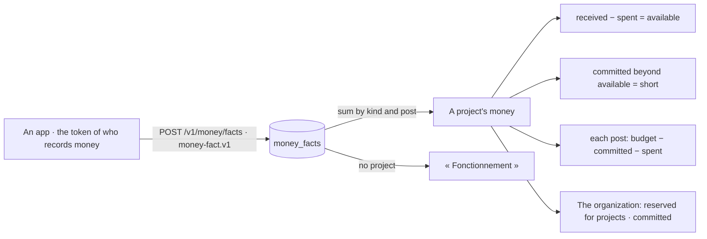

# Spec 076 — Money by project

Step **F4** of the plan (`docs/ROADMAP.md`, doctrine D-049): the apps say their facts of money to
the center, each with its project; the center adds them up.

## Why

« Il faut qu'on suive les fonds disponibles pour chaque projet, afin de séparer clairement, de
savoir ce qui avantage, et si les fonds sont utilisés pour ce qu'il faut. » A project's money was
nowhere: a quote in one tool, purchases in another. The money of one project paying another is the
most common mistake and the least visible.

## What changes

- **A fact of money** (`POST /v1/money/facts`) in the shape of kete-core's contract
  `money-fact.v1`: invoiced, received, committed or spent; an integer amount of the currency's
  smallest unit; its project, its budget post, its third party. Said by an app with the token of a
  person who records money (`money:record`). Said again under its key, it is replaced; taken back,
  it is gone.
- **Checked on the way in**: its project exists and has its currency; its post is one of the
  project's budget; its third party is kept as the record that stays after a merge.
- **A project's money** (`GET /v1/money/projects/:id`): invoiced and still due, received,
  committed, spent; **available** — received less spent; **short** — what its commitments exceed
  its available funds by, or what it already spent beyond what it received; each post's budget,
  committed, spent and what is left; what was spent outside any post; and the pieces behind each
  figure.
- **Read by its lead**, and by who reads the organization's money (`money:read`). Its team sees
  the project, not its margin.
- **The organization** (`GET /v1/money`): what is reserved for projects — the sum of what is left
  of each project's funds, money that is not the organization's to spend — what is committed, what
  runs outside projects, and how many projects are short.
- **On the screens**: a project's page shows its money and its budget bars, with the alert when
  its commitments exceed its funds; « Projets » shows funds by project to who reads them all.
- **The demo**: six facts written in advance for « Chantier Garage Bè » — no app says them yet.

## What stays for later

What is in the bank, the tills and mobile money, and so « really available »: the treasury's to
say (Gestion, step G3). A funder's rules of spending applied to a fact (Engagements). Time and
shared costs charged to a project. A request for a purchase checked against a post before it is
approved — it is Gestion's gesture, with this reading. Several currencies added up.

## Proof

- `apps/api/tests/money.test.ts` (7): a fact is said by who records money, and refused when the
  contract refuses it, when its project or post does not exist, when its currency is not the
  project's; **a project's available funds follow what Gestion sends** — 992 000 received,
  896 000 spent in three posts, 700 000 committed: 96 000 available, short of 604 000, and
  130 000 left on « Matériel »; a fact said again replaces itself and one taken back is gone; what
  is spent outside the budget is counted apart; a fact follows its third party through a merge;
  the money is read by its lead and by who reads the organization's, not by its team; the
  organization's reserved and committed add up.
- Seen with `pnpm demo` on 2026-10-13, as Abla Nyuiadzi, on « Chantier Garage Bè »: « Reçu 992 000 F
  CFA », « Engagé 700 000 F CFA », « Dépensé 896 000 F CFA », « Disponible 96 000 F CFA »; the alert
  « Engagé 700 000 F CFA pour 96 000 F CFA disponibles : sans nouvelle entrée, 604 000 F CFA seront
  pris sur l’argent d’autres projets. »; « Matériel — 1 320 000 F CFA sur 1 450 000 F CFA · reste
  130 000 F CFA »; and « Les pièces derrière ces chiffres (6) ». The facts are written in advance.
