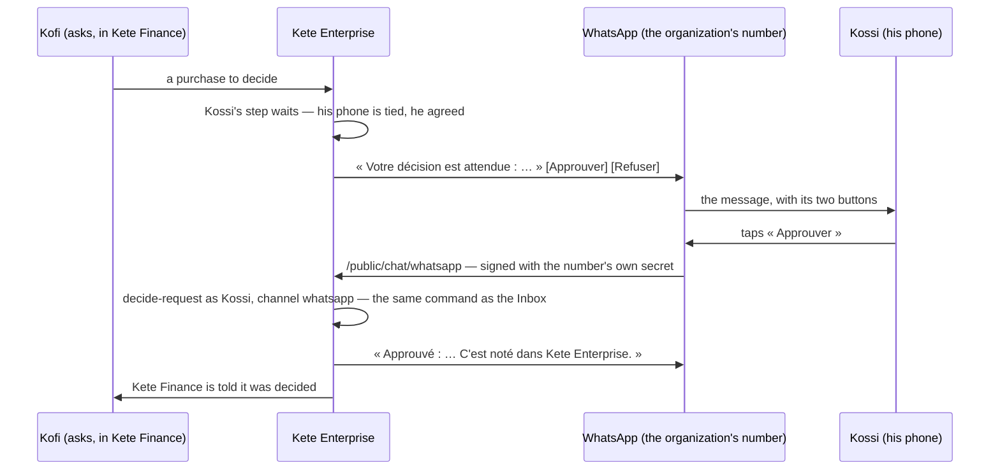

# Spec 077 — The center on a phone

Step **F5** of the plan (`docs/ROADMAP.md`): what waits for a person's decision reaches her on
WhatsApp or Telegram, and she decides it by a reply.

## Why

A director approves purchases between two meetings, from her phone. If a request waits in an Inbox
she opens twice a week, the site waits two days for its cables. The decision must reach her where
she is — and stay hers: journaled as hers, refused when it is not hers, never taken by a message
someone could forge.

## What it gives

- **The organization's number and bot**: an administrator connects its WhatsApp Business number
  and its Telegram bot (`@kete/notify`); their secrets are sealed with the instance's key and never
  shown again.
- **Her phone**: a person ties her WhatsApp (her number) or her Telegram (she opens the bot with a
  code once) — by a gesture of hers; she unties it the same way. Nothing reaches a phone she did
  not tie.
- **What waits for her decision** — a request reaching her step — is sent to her phone with two
  buttons, « Approuver » and « Refuser ».
- **Her tap decides**, as her Inbox would: the same command, journaled as hers through
  `whatsapp` or `telegram`; the app that asked is told. A message delivered twice decides once; a
  tap on what is no longer hers is answered so, and changes nothing; a webhook not signed with the
  number's own secret is refused. A reply proves who she is, never that she administers: only her
  own steps are decided this way.
- **Screens**: « Mon téléphone », with the administrator's form for the number and the bot.

## What stays for later

- Sending back for correction from a phone: it needs a reason, written — today the reply says to
  open the Inbox.
- Other things that wait for her (a colleague's request, an agent's question) on her phone.
- A reminder when a request waits too long.
- Never proven with a real number or a real bot: the WhatsApp number and Telegram bot of Kete's
  workshop are another lane's; the organization's own are to be given.

## Proof

- `apps/api/tests/phone.test.ts` (6): **a decision is taken by a reply on a phone** — only an
  administrator connects the number; nothing is sent to a phone not tied; once tied, what waits
  arrives with its two buttons; her tap approves it, journaled as hers through `whatsapp`, and she
  is answered; the same tap delivered twice decides once, a tap on what is no longer hers changes
  nothing; a forged webhook is refused; untied, nothing more arrives.
- The decision, circuit, notification and app tests pass unchanged (32 with this file).
