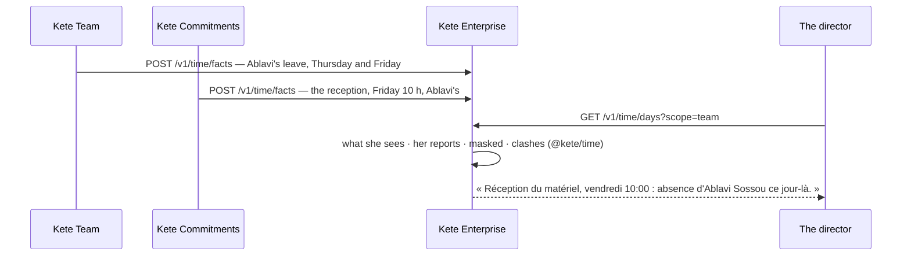

# Spec 079 — Planifier

Step **C12** of the plan (`docs/ROADMAP.md`; doctrine D-050; kete-core spec 102): the center's
fourth place — the time of the whole organization, as the apps say it, shown to each person within
what she may see, and what clashes said first.

## Why

The leave lives in Kete Team, the reception of the material in a project, the invoice's deadline
in Kete Finance, a meeting in her own agenda. Nobody sees on Thursday that Friday's reception is the
person on leave's: the site waits. The doctrine gives the center a place for time (D-050), fed by
the apps' dated facts (`dated-fact.v1`), computed — never guessed — by `@kete/time`.

## What it gives

- **The apps say their time**: `/v1/time/facts` keeps a dated fact per app and key — replaced when
  said again, gone when cancelled; `/v1/time/facts/drop` takes one back. A person says the facts
  that concern her; `time:record` says the time of others (an app's agent, an assistant).
- **Planifier** (`/planifier`), the fourth place of the frame:
  - **Ma vue**: her week hour by hour — her meetings, tasks, the apps' deadlines, the agents' runs.
  - **Mon équipe**: her reports' lanes, day by day.
  - **Toute l'organisation**, with `time:read`.
  - What clashes, said first: someone expected while away, someone in two places at once.
  - The week before, this week, the week after.
- **What another person sees**: a « busy » fact as « Créneau pris », another person's absence as
  « Absence » — never its reason; a private fact only by the people it concerns.

## Proof

- `apps/api/tests/time.test.ts` (3, against Postgres): said by the person or by `time:record`,
  refused otherwise and when the contract refuses it; her view, her manager's « Mon équipe » with
  the leave masked and the clash said, a colleague who sees only his own and the organization-wide
  deadline, the organization for `time:read` with the busy meeting masked, another organization
  seeing nothing; replaced under its key — the clash gone — and taken back.
- In the demo (`pnpm demo --fresh`): five dated facts this week; as the director, « Mon équipe »
  says « Réception du matériel — Garage Bè, vendredi 10:00 : absence de Ablavi Sossou ce jour-là »,
  her lanes showing « Absence » and « Créneau pris ».

## What stays for later

Blocks proposed for her tasks in her free time (`freeSlots`, `proposeBlocks` of `@kete/time`) with
« Garder » and « Retirer »; settling a clash in one gesture — the app that owns the fact acts on it;
her own agenda read from an ICS feed (`icsAgenda`); the apps sending their facts (G4, H2, I2).
