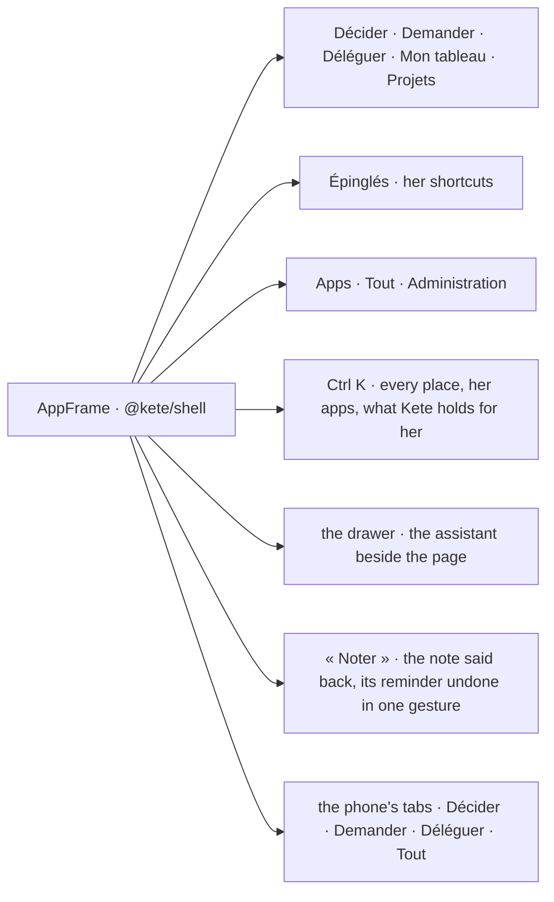

# Spec 082 — The frame on the shell

Step **C1** of the plan, continued (`docs/ROADMAP.md`; doctrine D-042, D-050; kete-core spec 100):
the center wears the same frame as every Kete app — `AppFrame` of `@kete/shell` — with its places
named by what she does there.

## Why

The center's sidebar had grown to some twenty places a person arranged herself (spec 049), and its
frame was its own: the apps' frame, built in kete-core, drew the same parts differently. A person
going from Kete Finance to the center changed of frame; and the center opened on a menu, not on what
waits (D-045, rule 1). The doctrine names the center's places by what one does there: Décider,
Demander, Déléguer — and Planifier (D-050).

## What it gives

- **The places**: Décider (`/`, « À faire » with it), Demander (`/assistant`, the threads and
  dossiers with it), Déléguer (`/mes-agents`, routines and skills with it), Mon tableau
  (`/tableaux-de-bord`), Projets; then what she pinned, in the sections she named (spec 049); then
  Apps and « Tout »; then the Administration — its own entries when she is in it.
- **Ctrl K** finds every place her modules open, her team's apps, and what Kete holds for her under
  her rights (spec 046); a question opens the assistant.
- **The drawer** holds the center's assistant beside the page (spec 048) — its threads, tables,
  drafts and files — in the shell's drawer; Ctrl J opens it.
- **« Noter »** (N, or the pen) keeps the note in her notebook and says back the reminder it filed,
  with its undo, in the dialog (spec 055).
- **The phone's tabs**: Décider, Déléguer, then « Demander » in the middle, then Projets and « Tout ».
- Her mode (dark, light, automatic) and « Se déconnecter » in the frame's footer; the notifications'
  bell with what is unread.

## What changes for her

- The sidebar is no longer arranged place by place: the places are the doctrine's; her pinned
  shortcuts stay, in their sections. Every other place is under « Tout » and Ctrl K.
- Planifier joins the places with its page (step C12).

## Proof

- `pnpm typecheck` and the web's tests; every page still renders inside `AppShell`, whose signature
  did not change.
- In the demo (`pnpm demo --fresh`): the four places with Décider's count, the pinned sections,
  Ctrl K finding a place and a record, the drawer opened by Ctrl J with the page it sees, « Noter »
  saying back its reminder, the Administration's entries, the phone's tabs at 375 px.

## What stays for later

The drawer's stream on `@kete/intelligence` (the contract `intelligence-event.v1`) — the center's
chat keeps its own until its tables, canvas and views have their events in the contract; Planifier
(C12); the morning's pile (C2).
