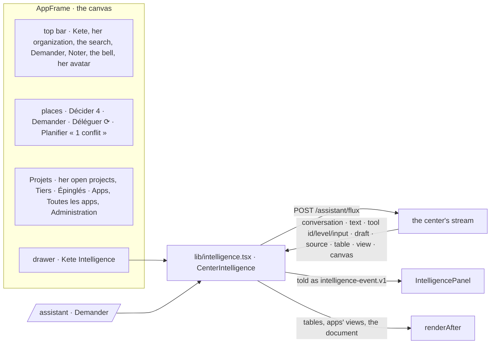

# Spec 085 — The center in the validated canvas: the frame, Kete Intelligence, « Demander »

Step **C1** redone, and the center's Kete Intelligence (`docs/ROADMAP.md`; doctrine D-042, D-045,
D-050; kete-core specs 101 and 108). The center wears the frame and the drawer exactly as the
validated canvas v3.1 draws them, from the same packages as every Kete app. Specs 082 and 048 had
built them their own way.

## Why

The canvas is the interface the person validated. The center's frame and its assistant were close
to it, but they were not it. The sidebar was different, the assistant had its own drawer, and the
page « Demander » was its own too. Kete-core now ships the canvas's frame (`AppFrame` on
`CanvasFrame`) and its drawer (`IntelligencePanel`). The center uses them, and keeps every gesture
its assistant had.

## Requirements

- **FR-001 — The frame** (`lib/shell.tsx`):
  - the top bar: Kete, her organization, the search, « À jour » (or offline), « Noter »,
    « Demander », « Fichiers », the bell, her avatar with her mode and « Se déconnecter »;
  - the places:
    - Décider with what waits for her, in bold;
    - Demander;
    - Déléguer, with a spinner while an agent works for her;
    - Planifier, with « 1 conflit » when her week clashes;
  - « Projets »: her open projects (a square each), « Tous les projets », « Tiers »;
  - « Épinglés »: Mon tableau and her shortcuts;
  - the foot: her organization's apps under « Apps », folded, then « Toutes les apps » and
    « Administration »;
  - the phone's tabs: Décider, Planifier, « Demander » (the page), Déléguer, Menu;
  - each page in the frame's measure (`FramePage`, wide for Planifier and the boards); the page
    « Demander » fills the frame itself.
  - `/v1/me` adds her organization's name, her open projects, whether an agent works for her now,
    and the clashes of her week.
- **FR-002 — Kete Intelligence beside every page** (`CenterIntelligence` in the frame's drawer).
  It is the canvas's drawer:
  - its head (Demander, Fichiers, the threads, a new thread, wider, close);
  - the page she looks at as a context she may remove — the place she stands in when the page
    said nothing — and how far it looks (« Dans tout Kete »);
  - « Fichiers »: a file dropped or chosen joins her next question; her recent documents;
  - the greeting, kept at the top;
  - each answer with its seconds and what it does now;
  - each capability with its level and what it was called with;
  - its drafts as their verification card (Valider, Refuser), its words, its sources;
  - « Épingler au tableau », « Utile » / « Pas utile », « Copier », « Régénérer » and its tally;
  - its suggestions.

  The field:
  - joins files, read by the center (spec 027);
  - cites a colleague or an app after @, and asks a shipped gesture after / (spec 031). Both are
    sent as the directives the center reads;
  - writes her voice as she speaks.

  The tables it read, the apps' views (spec 030) and the document it wrote show after its words.
- **FR-003 — The stream tells each capability's call** (`apps/api`): its call id, its autonomy level
  and what it was called with (cut to 240 characters).
- **FR-004 — « Demander »** (`/assistant`): her threads on the left, each with when it moved;
  « Nouveau fil ». Kete Intelligence sits in the middle, 880 px wide at most. The document it wrote
  opens beside it. The thread's own gestures sit under her threads: pin it, keep it as a skill, her
  memory, her exchanges, her scheduled tasks, the connection, who pays. A question from Ctrl K is
  asked once.
- Every word comes from the catalogs. The old chat drawer and its assistant-ui thread are gone; no
  gesture they had is lost.

## Proof

- `pnpm typecheck`, lint, format, i18n and the tests of api and web (`apps/web/tests`: the
  center's stream told as `intelligence-event.v1`, the directives, a thread opened again).
- In the demo, side by side with the canvas (desktop 1440 px and phone 390 px, light and dark):
  - the frame, with its places and what waits in them;
  - the drawer opened on Décider, after a question;
  - the page « Demander » with a thread opened again.

## What stays for later

The canvas's own pages: Décider (Matin, Soir, Semaine), Planifier, Mon tableau, Déléguer and the
project. In « Fichiers », what was received by WhatsApp or mail, to read; « Dans cette app » once
the center's apps answer in the drawer. Threads grouped by project. Long research in the threads.
