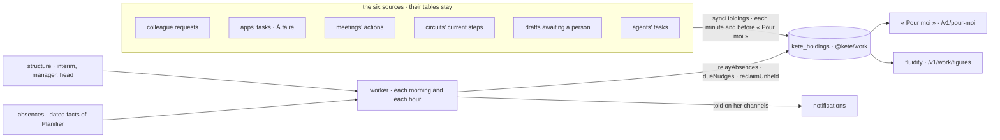

# Spec 087 — Holdings in the center: six sources, the relay, « Pour moi »

Step **W** of the unification (`docs/ROADMAP.md`; decision 0002; doctrine D-056, D-057;
kete-core spec 111). The author's go came on 2026-10-16 (« vas au bout proprement »), with the
simulation validated.

## Why

The center says « a thing in progress » six ways: a colleague's request, an app's task in « À
faire », a meeting's action, a circuit's step, an agent's draft awaiting a person, an agent's task.
Each has its own status and holder; none answers « who holds what » for the whole organization,
and nothing moves when a holder is away. `@kete/work` (kete-core) is that answer: one holding,
always a holder, the relay. The center now keeps its six sources as holdings.

## Requirements

- **FR-001 — The six sources as holdings** (`features/work`). One sync says every open item of
  the six sources as a `holding.v1`, under its source (`enterprise`, kind, reference), and closes
  the holdings whose item closed:
  - a colleague's request: held by the colleague asked (her agent once she handed it to it); it
    waits on the requester when she asked him back; done once returned, declined or cancelled;
  - an app's task in « À faire »: held by its person, due on its day;
  - a meeting's action: held by its responsible person, due on its day;
  - a circuit's current step: held by its first approver today (the administrators' first when the
    step finds nobody); the requester sees it as waiting on the circuit;
  - a draft prepared by an agent: held by the person it was prepared for, until she decides;
  - an agent's task: held by the agent while it is queued or running.

  A holder is a person's account (`usr_…`); a person without an account holds by her person id
  (`prs_…`); an agent by its id. The sync runs each minute and before « Pour moi » is read.
- **FR-002 — The relay** (worker). Each morning at 07:00 and each hour in working hours: the
  holdings of a person away today (her absences in Planifier) pass to her interim, else her
  manager, else the organization's head; the new holder is told through her notifications, and may
  hand it back with a reason. Holdings whose holder left pass to her manager; what nobody can take
  is told to the administrators. Waits are nudged in working hours.
- **FR-003 — « Pour moi »** (`GET /v1/pour-moi`): what she must answer, what she holds, what she is
  told, by urgency then age, each with its link back to its source.
- **FR-004 — The figures** (`GET /v1/work/figures`, administrators): the oldest wait, the waits
  over 48 hours and with whom.
- **FR-005 — Hand back** (`POST /v1/pour-moi/:holdingId/rendre`): the person the relay gave a
  holding to gives it back, with her reason.
- Every word from the catalogs; nothing new is written into the six sources (decision 0002).

## Proof

- Tests (api): each source gives its holding and closes it; a request taken, asked back, returned;
  an absence in Planifier moves a person's holdings to her interim the same day; « Pour moi »
  gathers holdings from several sources; hand back; the figures.
- The demo: Abla's « Pour moi » lists what she must answer and holds, from several sources.

## Not done here

The screen « Pour moi » in the canvas v5 (step E, spec 090); each source writing its holding
directly as it is absorbed into `work` (decision 0002), which retires the sync; the policies at the
gesture (088).
