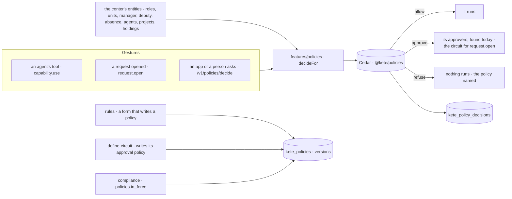

# Spec 088 — One policy engine at the gesture: circuits and agents' rules melt into it

Step **G** of the unification (`docs/ROADMAP.md`; decision 0002; doctrine D-058; kete-core
spec 112). The author's go came on 2026-10-16 (« vas au bout proprement », then « suis le plan »),
Cedar kept after its first check.

## Why

The center answers « who may do what, up to how much, with whose approval » with two engines: the
circuits of `decisions` (D-028) for people, the rules of `rules` (D-043) for agents. Agents are
going to write to clients and commit money; trust needs one answer, the same for a person and for
an agent, journaled with the policy that decided it. `@kete/policies` (kete-core) is that engine.
The center now decides with it.

## Requirements

- **FR-001 — The engine of the center** (`features/policies`). The center's Cedar schema (people
  in their roles and units, with their manager, deputy and absence; agents with the person they
  work for and their autonomy; projects with their lead; holdings as cards with their holder;
  subjects of circuits; capabilities), Kete's base policies (a capability may be used, a request
  opened), the organization's policies and their journal (`@kete/policies`, RLS in the same
  migration). `decideFor` reads the entities a gesture touches from the center's own records and
  journals each decision.
- **FR-002 — Agents' rules are policies.** A rule (spec 068) is a form that writes a Cedar policy
  in the authority set: `tools` forbids its permissions to agents, `autonomy` forbids an agent to
  act alone on them. The gateway asks the engine for every tool an agent is given and for a
  copilot's calls (`capability.use`); the refusals and the counts on trial are read from the
  journal; a rule is tried on the last month by the engine itself. The routes `/v1/rules` keep
  their shape; the old journal of refusals is carried into the new one and retired.
- **FR-003 — Circuits are policies.** Defining a circuit writes its approval policy
  (`circuit.<subject>`, approver `circuit`); a feature opening a request asks the engine
  (`request.open`): an approval opens the circuit, whose steps find their approvers as before;
  an allowance leaves the feature its own review; a refusal stops it. Existing circuits are
  carried into policies.
- **FR-004 — Approvers found today.** An approval names its approver by relation or role —
  `manager`, `project.holder`, `on_behalf_of`, `role:<id>`, `position:<id>`, `person:<id>`,
  `circuit` — resolved from today's structure; an absent manager passes to her deputy.
- **FR-005 — Policies written and observed** (`/v1/policies`, administrators): the policies and
  their counts this month; a policy's versions and journal; a sentence's Cedar rule proposed by the
  model and checked against the schema; a policy saved as a new version, always born on trial;
  switched on only once it was observed on trial; the journal by policy.
- **FR-006 — Ask at the gesture** (`POST /v1/policies/decide`): a person, an app on her behalf or
  her agent sends a `gesture.v1`; the answer is a `policy-decision.v1` with its approvers found,
  journaled. A gesture the schema does not know is refused, never allowed.
- **FR-007 — Compliance points to it.** The automatic check `policies.in_force` proves the policies
  hold: none observed on trial for more than thirty days without its owner deciding, none whose
  rule no longer fits the schema.
- **FR-008 — The six policies in the demo.** KYA's demo writes the six policies (signature powers;
  speaking to clients, channel, hours, templates; spending limits; deputies; retention and
  confidentiality; consent) on its own roles and positions — one of them on trial.
- Every word from the catalogs.

## Proof

- Tests (api): the same purchase by Kossi and by his agent goes through the same policy, each with
  its approver found; a refusal names its policy and version; a policy on trial never blocks and is
  journaled; a gesture the schema does not know is refused; the rules' tests (spec 068) pass
  unchanged on the engine; a circuit opens through its policy; `policies.in_force`.
- The demo: KYA's six policies are listed, and « le client a écrit STOP » is refused.

## Not done here

The governance screens on the v5 canvas (spec 090); the commands of the center asking the engine
for themselves through `executeCommand`'s `authorize` (each as its gesture appears in the threads
and channels, spec 089); a policy's scope by unit and project in the screens.
