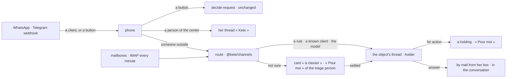

# Spec 089 — Threads and channels in the center: a thread per object, the router, mail bridged

Step **M** of the unification (`docs/ROADMAP.md`; decision 0002; doctrine D-056, D-057; kete-core
spec 113). The author's go came on 2026-10-16 (« vas au bout proprement », « fais tout »).

## Why

The center talks in five places — the assistant, exchanges between assistants, the phone,
notifications, mail — and a client's WhatsApp message to KYA's number is dropped when nobody tied
that phone. KYA writes mail mostly to keep a trace. `@kete/threads` and `@kete/channels`
(kete-core) give one place per object, a trace at least as good as mail, and a router that ties
what the outside says to its object's thread with a holder — never guessed.

## Requirements

- **FR-001 — Threads** (`/v1/threads`): her threads; a group or a direct thread she opens; her
  thread « Kete »; an object's thread; a thread's messages, read by her as she opens it; a message
  posted — for action to someone, or for information —, edited (the original kept); search; the
  export with its journal and fingerprint (a PDF when the conversion service is configured). A
  thread is read by its members and the administrators.
- **FR-002 — The router of the center.** Triage by the organization's head (else its assistant);
  an object's thread held by the project's lead; a client known by her phone or e-mail lands in her
  open project's thread (else her party's); the model reads the rest when one is configured, above
  0.8; under it, a card « à classer » in the triage person's « Pour moi », settled by
  `/v1/threads/triage/settle` — and learned.
- **FR-003 — WhatsApp and Telegram inbound.** A message from someone outside is routed and
  acknowledged; a person of the center writing without a button finds it in her thread « Kete »;
  the buttons of the decisions work as before.
- **FR-004 — Mail bridged.** An administrator connects a person's mailbox (IMAP and SMTP; the
  password sealed, never returned); the worker reads it every minute and routes each mail; an
  answer written in a thread whose contacts write by mail leaves from her box, in the conversation
  (In-Reply-To the last mail; Reply-To the thread's address when it has one), and is kept in her
  Sent folder; the reply comes back into the thread.
- Every word from the catalogs.

## Proof

- Tests (api): a client's WhatsApp message lands in its project's thread with the lead as holder,
  and in her « Pour moi »; an unknown sender raises « à classer », settled and learned; an answer
  by mail leaves from her box in the conversation and its reply comes back; a person's message to the number
  lands in her thread « Kete »; an edit keeps the original; a non-member cannot read a thread; the
  export's fingerprint.

## Not done here

The assistant's conversations, the exchanges between assistants and the meetings written as
threads (their sources absorbed one by one, decision 0002); answers to a client on WhatsApp from a
thread (its 24-hour window and templates); each object thread's own address for replies, on a reply
domain the center reads (plus-addressing on one mailbox); the screens on the v5 canvas (spec 090).
