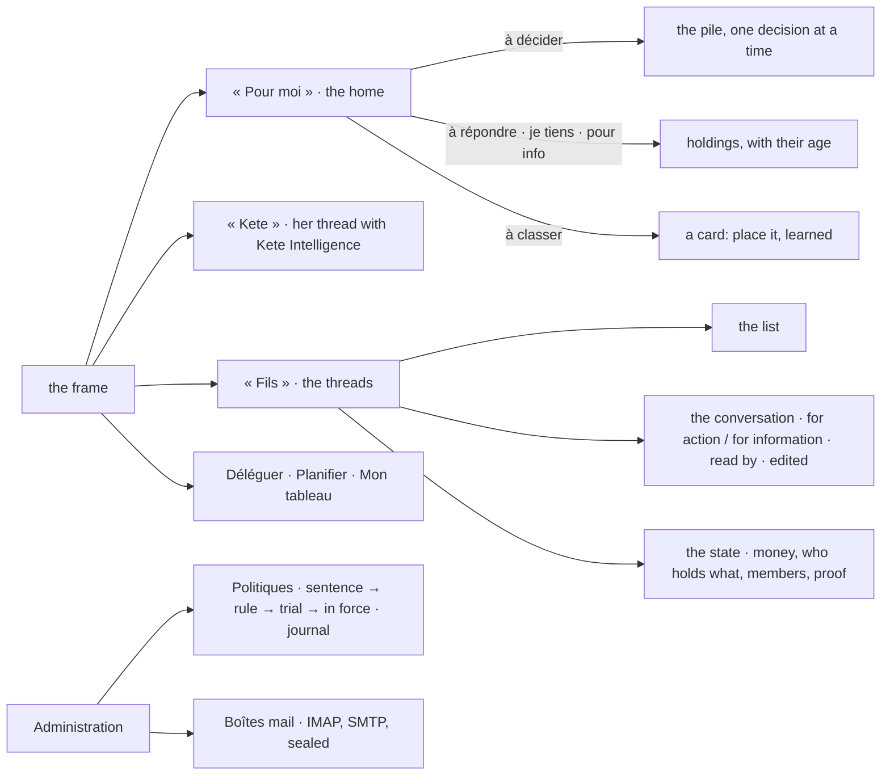

# Spec 090 — The screens of the living model: « Pour moi », the threads and their state

Step **S** of the unification (`docs/ROADMAP.md`; decision 0002; doctrine D-056 to D-058). The
author's go came on 2026-10-16 (« Vas-y à l'implémentation »). The model is in place — holdings
(087), policies (088), threads, channels and the router (089); this spec gives it its screens, in
several pull requests, on the frame and Kete Intelligence of spec 085.

## Why

Doctrine D-057: each known tool serves one of three things well — attention, conversation, state
— and the other two badly. Kete separates them and ties them by the same objects. The center
still opened on « Décider » and its conversation lived in the assistant alone; the threads, the
cards « à classer », the policies and the mailboxes had no screen.

## Requirements

- **FR-001 — The frame (D-057).** The places become « Pour moi » (with what waits), « Kete »
  (her thread with Kete Intelligence, the page « Demander » renamed), « Fils », Déléguer,
  Planifier; her projects, « Tiers », what she pinned, « Mon tableau ». The phone's tabs: Pour moi,
  Fils, Planifier, with Kete in the middle.
- **FR-002 — « Pour moi » is the home.** The decisions one at a time (the pile, unchanged); then
  **à répondre**, **à classer** (each card says what was received and where from; she places it in
  a project or a third party, with its intent; it is learned), **ce que je tiens** (beyond what the
  pile shows, with its age or its due day, « Rendre » when the relay gave it to her), **pour
  info**; then what her agents do, her pinned views, the briefing.
- **FR-003 — The threads.** Her threads by kind (objects, groups, direct); a new group in one line.
  A thread: its messages by day, each with its author (a person, an agent, a contact named by the
  third party the center knows), its channel, « pour action → quelqu'un » or « pour info », « lu par »
  with the hour, « modifié »; her own message edited in place, the original kept. The composer: for
  information or for action (to a member, else the thread's holder), also by mail from her box when
  its contacts write by mail. Beside it, **the state**: the project's money (invoiced, received,
  committed, available), who holds what on its object and since when, its members since when, its
  address, the proof exported with its fingerprint.
- **FR-004 — « Kete ».** The page of Kete Intelligence (085) shows, beside her conversations, what
  she told Kete from her phone (WhatsApp, Telegram).
- **FR-005 — Politiques** (administrators): a sentence, the rule the model proposes with what it
  does, checked against the schema, corrected if need be, kept on trial; each policy with its
  version, its set, its approver, what it did this month, its rule; put in force, back on trial,
  off; the journal of decisions (gesture, who, effect, by which policies, what the policies on
  trial would have done).
- **FR-006 — Boîtes mail** (administrators): the boxes read, and a person's box connected (IMAP,
  SMTP, login, password sealed and never shown again).
- **FR-007 — Planifier** shows every holding due on a day as a task of its holder's week (apps'
  own tasks stay theirs, said as dated facts).
- **FR-008 — Mon tableau** shows the organization's fluidity to its administrators: what is in
  progress, what waits on someone, the waits over 48 hours, the oldest one with its link.
- **FR-009 — The agents' page** lists the policies that bound them, in their sentences, in force or
  on trial, read by every member (`GET /v1/policies/agents`); the rules stay with administrators.
- **FR-010 — The threads on a phone**: the list is its own screen; a thread has its way back; its
  state folds behind « L'état » and closes. The Kete Intelligence button and the phone's middle tab
  say « Kete ».
- **The demo** writes Garage Bè's WhatsApp message into its project's thread, a colleague's ask for
  action, a mail « à classer » with the head, and the direction's group.
- Every word from the catalogs, French and English.

## Proof

- In the demo (`pnpm demo`): Abla's « Pour moi » lists Garage Bè's message and Délali's ask, held by
  her, linked to the project's thread; the thread shows « Garage Bè » by name, the project's money,
  who holds what; a message sent « pour action → Délali » appears with its holding in the state;
  the policies list KYA's six policies with their trial.
- api tests unchanged and green; web build, typecheck, lint, format and i18n green.

## Next, in this spec

The bell folded into « Pour moi »; the morning point written into the thread « Kete »; Planifier's
proposed blocks for the holdings without a slot; screenshots side by side, computer and phone,
light and dark, once the v5 canvas is validated.
