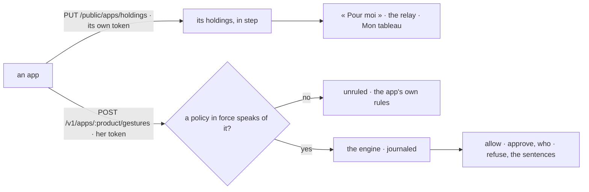

# Spec 091 — The apps on the living model: their holdings and their gestures

Step **A5** of the release (the doctrine's `FEUILLE_DE_ROUTE.md`; decision 0002; kete-core spec
114). The author's go came on 2026-10-17 (« Passe à A5 : les quatre apps du centre sur le modèle
unifié »). Kete Finance, Team, Commitments and Support adopt it in their own specs.

## Why

The center holds every thing in progress as a holding and decides every gesture with one policy
engine (specs 087, 088). What waits in the apps — an invoice on its client, a leave sent back, a
ticket on its requester, a contract's obligation — never reached « Pour moi » nor the relay; a
policy written here (« un agent ne signe jamais ») did not stop the same gesture made in an app.

## Requirements

- **FR-001 — An app's holdings** (`PUT /public/apps/holdings`, the app's own token): only from the
  app the registry holds under that client and product; every holding in the shape of
  `holding.v1` under its product, at most 2 000; what it no longer says is finished; a holding the
  relay gave to someone keeps who stands in; a holding whose holder is nobody the center knows is
  refused, said back (`refused`), never kept for nobody.
- **FR-002 — Where it opens.** A holding keeps the address its app gave it (`href`, migration
  0066); « Pour moi » and the relay's notification open it there — an https page of the app or a
  path of the center, nothing else.
- **FR-003 — An app's gesture** (`POST /v1/apps/:product/gestures`, the person's token, and her
  agent's id when it acts for her): only for an app the registry holds; only a gesture the center
  rules for apps — `purchase.commit`, `contract.sign`, `invoice.issue`, `assignment.make`,
  `message.client` — on the objects each acts on. While no policy in force speaks of it, the
  verdict is `unruled` and the app keeps its own rules; otherwise the engine decides and journals,
  as for the center's own gestures: `allow`, `approve` with who approves found today, `refuse` with
  the policies' sentences. Where the policies in force only forbid or ask an approval — none allows
  — what the app allows is allowed (`kete.app-rules`), under those forbids and approvals: « un
  agent ne facture jamais » refuses the agent and leaves the person to the app's rules.
- **FR-004 — The schema** gains `invoice.issue` (a party, a project or a subject; its amount) and
  `assignment.make` (a project; its days); a purchase may be on a subject, a contract on a party or
  a subject.
- The center's own six sources are kept in step the same way (`syncSource`).

## Proof

- Tests (api): an app's holdings refused without its token, from a stranger, under another source;
  kept, in their holder's « Pour moi » with their address, an unknown holder refused, a holding no
  longer said finished; a gesture unruled while nothing speaks of it, allowed, to approve by the
  manager, refused for the agent and journaled; a forbid alone refusing the agent and leaving the
  person to the app's rules; an unknown gesture, a wrong object, an app the
  registry does not hold refused.

## Not done here

An approval of an app's gesture outside its circuits opened as a card by the center (`approve`
names who approves; the app takes its own approval path or refuses with who must approve); the
app's name beside its holdings in « Pour moi »; a thread per app object.
