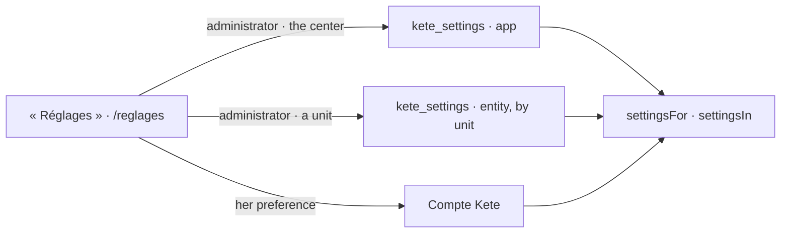

# Spec 092 — « Réglages » in Kete Enterprise, and each unit's settings

A6 of Kete's release (doctrine D-060: « Le même panneau « Réglages » est dans le cadre de chaque
app » ; « l'entité juridique ou l'unité (une filiale, un site : plus précise que l'app) »);
kete-core decision 0013, specs 115 to 117. Run on the author's go of 2026-10-17 (« vas au bout »).

## Why

The center had no settings page: a person set her preferences only in Mon espace, an administrator
could not say that KYA Ghana bills in cedis while the group bills in F CFA, and nothing in the
center read the organization's own settings.

## Requirements

- **FR-001 — Storage**: the migration `0067_kete_settings` (`@kete/settings`), its RLS policy and
  its journal.
- **FR-002 — The API** (`/v1/settings`): read as she sees them, or at a unit for an
  administrator, the units above it included from the broadest to the most precise; set and take
  back her preference (in the Compte Kete), the center's and a unit's (an administrator).
- **FR-003 — The page** « Réglages », at the foot of the places for everyone: the panel of
  `@kete/shell` — her preferences, then the organization's; for an administrator, a unit chosen
  shows what it sets for itself.
- **FR-004 — Commands** read with `settingsIn(db, organizationId, unitId?)`.

## Proof

- Tests: a value with its layer (Kete's default, the organization's from the Compte Kete); a member
  refused the center's layer and a unit's; a value out of schema refused; KYA Ghana's currency
  wins at the site of Accra below it, the group keeps F CFA, a command at Accra reads cedis; taken
  back, Accra inherits again; her theme saved in the Compte Kete and read back as hers.

## Not done here

A setting's history shown beside it; the units' settings read by the documents (who bills, with
which legal mentions) — with A6's legal entity on the facts.
